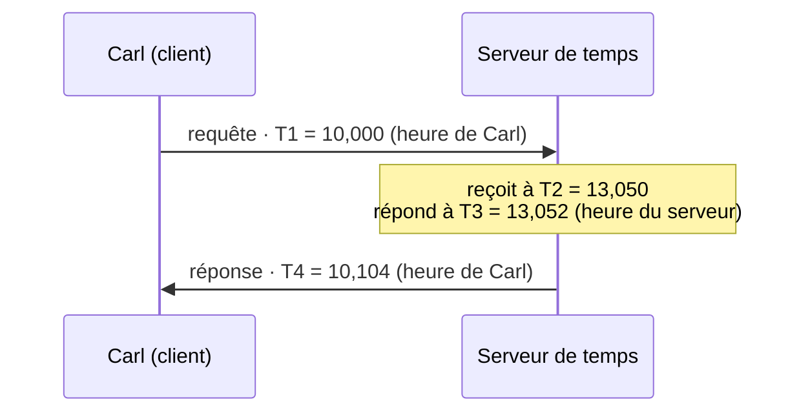
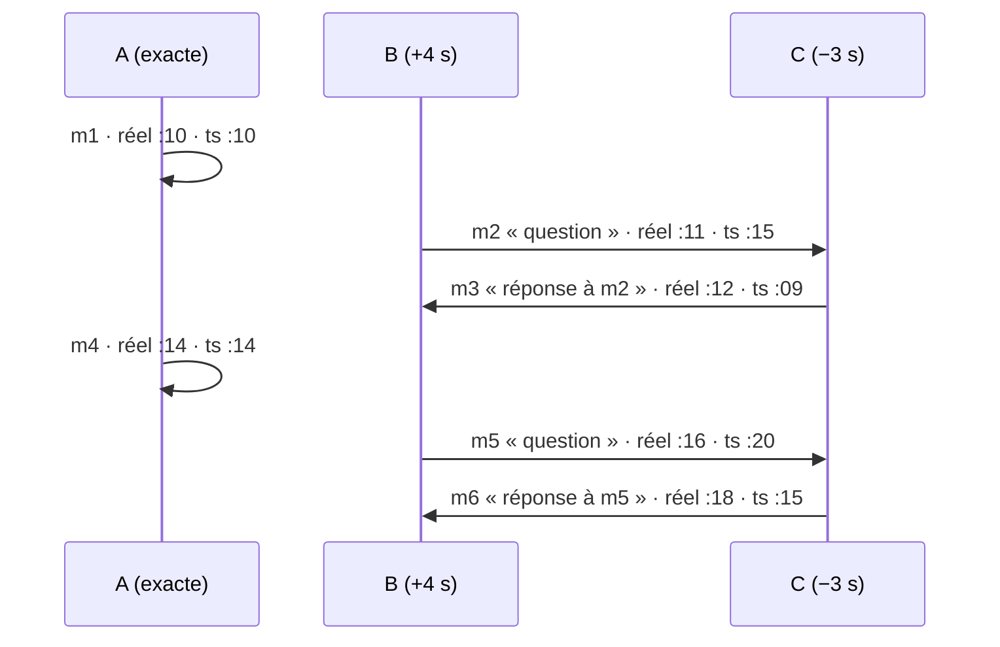

# D02 — Temps : trier des messages quand les horloges mentent

| | |
|---|---|
| Thématique | [Temps](../../thematiques/02-temps.md) |
| Fallacy | « tout le monde connaît l'heure » |
| Durée | 35 min (+ 10 min pour la partie D, optionnelle) |
| Matériel | Docker (aucune installation sur votre machine), papier, crayon |
| Théorie | [NTP](../../supports/ntp.md) : [NTP en pratique](../../supports/ntp.md#ntp-en-pratique) · [Alternative logique (Lamport)](../../supports/ntp.md#alternative-logique) |

## But
Voir qu'une horloge se trompe et dérive, calculer ce que NTP corrige, puis comprendre pourquoi trier un chat sur l'heure locale reste fragile.

## Partie A — Prise en main : interroger l'heure (15 min)

> Théorie : [Mettre les horloges à l'heure : NTP](../../supports/ntp.md) (strates, précision).

**1. Ouvrez un conteneur** avec les deux outils du drill : `chrony` (client NTP) et `faketime` (fausse horloge pour un programme).

```bash
docker run --rm -it debian:12-slim bash
# dans le conteneur (≈ 30 s) :
apt-get update && apt-get install -y chrony faketime
date -u +%Y-%m-%dT%H:%M:%SZ
```

→ Vous voyez par exemple `2026-11-11T10:31:44Z` : c'est le format **ISO 8601 en UTC** (le `Z` final) que le contrat du chat impose pour `ts` ([enveloppe](../contrats/README.md#enveloppe)).

**2. Interrogez un serveur NTP** sans toucher à l'horloge (`-Q` = « mesurer seulement ») :

```bash
chronyd -Q "server ch.pool.ntp.org iburst"
```

→ Après environ 5 s : `System clock wrong by -0.028046 seconds (ignored)`. Votre horloge est à quelques millisecondes de l'heure du serveur : c'est l'**offset** de la [théorie](../../supports/ntp.md#ntp-en-pratique), calculé avec quatre horodatages (partie B).

> Aucune réponse au bout de 30 s ? Le réseau bloque probablement NTP (UDP 123). Prévenez l'enseignant et passez à l'étape 3 : `faketime` fonctionne sans réseau.

**3. Essayez de changer l'heure** du conteneur :

```bash
date -s "2020-01-01 00:00:00"
```

→ `date: cannot set date: Operation not permitted`. Un conteneur n'a **pas sa propre horloge** : il lit celle du noyau de la machine hôte, qu'il n'a pas le droit de modifier. Pour simuler une horloge fausse, on trompe **un seul programme** avec `faketime` :

```bash
faketime -f "+30s" date -u +%Y-%m-%dT%H:%M:%SZ
faketime -f "+30s" chronyd -Q "server ch.pool.ntp.org iburst"
```

→ `date` affiche 30 s d'avance, et NTP le détecte : `System clock wrong by -30.03 seconds`. C'est exactement ce que fera l'option `--clock-skew 30` de votre chat ([C2](../chat/C2-ordre.md)).

**4. Observez une dérive.** Une horloge ne fait pas que se tromper, elle **dérive** : elle avance un peu trop vite ou trop lentement. Simulez une horloge 1 % trop rapide et mesurez trois fois, à 20 s d'intervalle :

```bash
faketime -f "+0 x1.01" bash -c 'for i in 1 2 3; do chronyd -Q "server ch.pool.ntp.org iburst" 2>&1 | grep wrong; sleep 20; done'
```

→ Le décalage grandit à chaque mesure (par exemple −0,05 s, −0,17 s, −0,27 s). À ce rythme, combien d'écart après une heure ?

<details><summary>Réponse</summary>

1 % de 3600 s = **36 s par heure**. Un vrai quartz dérive bien moins (10 à 50 millionièmes, soit quelques secondes par jour), mais il dérive toujours : une seule synchronisation ne suffit pas, il faut **resynchroniser régulièrement**. Pour votre fil rouge, c'est la question de la *fréquence de diffusion* de l'heure.
</details>

Quittez le conteneur : `exit` (il est supprimé grâce à `--rm`).

> **Optionnel, sur votre machine.** Windows : `w32tm /stripchart /computer:ch.pool.ntp.org /samples:3 /dataonly` (colonne `offset`). Linux / macOS : `sntp ch.pool.ntp.org`.

## Partie B — Le calcul de NTP (5 min, papier)

> Théorie : [NTP en pratique](../../supports/ntp.md#ntp-en-pratique) (offset, delay).

**5. Calculez un décalage et un délai.** Carl (client) interroge un serveur de temps :



Formules : `décalage = ((T2 − T1) + (T3 − T4)) / 2` et `délai = (T4 − T1) − (T3 − T2)`.

Début du calcul : `T2 − T1 = 13,050 − 10,000 = 3,050`. À vous : `T3 − T4`, le décalage, puis le délai.

<details><summary>Réponse</summary>

`T3 − T4 = 13,052 − 10,104 = 2,948`. Décalage = (3,050 + 2,948) / 2 = **2,999 s** : Carl retarde d'environ 3 s. Délai = 0,104 − 0,002 = **0,102 s**. L'erreur possible sur le décalage est d'au plus `délai / 2` ≈ 0,05 s.
</details>

## Partie C — Trier un chat (10 min, papier)

**Situation.** Trois machines. **A** est à l'heure, **B** avance de 4 s, **C** retarde de 3 s (c'est Carl, de la partie B). Bob (B) pose deux questions, Carl (C) y répond. Chaque machine écrit son heure locale dans `ts`, en ISO 8601 UTC. L'**heure réelle** n'est connue de personne : elle sert ici à vérifier.



| Msg | Émetteur | Heure réelle | `ts` écrit | Remarque |
|---|---|---|---|---|
| m1 | A | 08:00:10 | `2026-11-02T08:00:10Z` | |
| m2 | B | 08:00:11 | `2026-11-02T08:00:15Z` | question de Bob |
| m3 | C | 08:00:12 | `2026-11-02T08:00:09Z` | **réponse** de Carl à m2 |
| m4 | A | 08:00:14 | `2026-11-02T08:00:14Z` | |
| m5 | B | 08:00:16 | `2026-11-02T08:00:20Z` | question de Bob |
| m6 | C | 08:00:18 | `2026-11-02T08:00:15Z` | **réponse** de Carl à m5 |

**6. Triez par `ts`.** Les deux premiers rangs sont donnés :

| Rang | Msg | `ts` |
|---|---|---|
| 1 | m3 | `…T08:00:09Z` |
| 2 | m1 | `…T08:00:10Z` |
| 3 | ? | ? |
| 4 – 6 | ? | ? |

Lisez le chat dans cet ordre : que remarquez-vous à propos de m3 ?

<details><summary>Réponse</summary>

Ordre : m3, m1, m4, m2 / m6 (égalité), m5.
La réponse de Carl (m3) s'affiche **avant** la question de Bob (m2) : le tri sur l'heure locale casse la logique de la conversation.
</details>

**7. Piège du format.** Trois autres `ts`, tous valides en ISO 8601. Triez-les d'abord **comme du texte** (ordre alphabétique), puis selon **l'instant réel** :

- `2026-11-02T08:00:10Z`
- `2026-11-02T08:00:10.5Z`
- `2026-11-02T09:00:05+01:00`

<details><summary>Réponse</summary>

- Comme du texte : `…10.5Z`, `…10Z`, `…09:00:05+01:00` (car `.` < `Z` et `08` < `09`).
- Instant réel : `09:00:05+01:00` (= 08:00:05 UTC), puis `08:00:10`, puis `08:00:10.5`. **L'ordre est complètement inversé.**

Règle : **convertissez `ts` en instant** (ou en millisecondes depuis 1970) avant de comparer, ne triez jamais la chaîne. Voir l'*astuce de calcul* de [NTP en pratique](../../supports/ntp.md#ntp-en-pratique).
</details>

**8. Et si tout le monde utilisait NTP ?** Carl corrige son horloge, ses `ts` deviennent exacts. Le tri par `ts` est-il maintenant juste ?

<details><summary>Réponse</summary>

*Presque* : il reste l'erreur de la partie B (≈ 0,05 s), et les horloges dérivent à nouveau (partie A, étape 4). Deux messages envoyés à 10 ms d'écart restent ambigus.
</details>

## Partie D (optionnelle) — Se passer de l'heure : Lamport (10 min, papier)

> Théorie : [Alternative logique](../../supports/ntp.md#alternative-logique). Pour aller plus loin dans le chat : [C2, défi](../chat/C2-ordre.md).

Règles : chaque machine a un compteur à 0.
- À l'**envoi** : `compteur + 1`, et le message porte cette estampille.
- À la **réception** : `compteur = max(compteur local, estampille reçue) + 1`.

**9. Estampillez.** Reprenez la scène de la partie C dans l'ordre réel. Pour simplifier, **seule C met son compteur à jour** (c'est elle qui répond) ; A et B ne font qu'envoyer.

| Msg | Qui | Calcul | Estampille |
|---|---|---|---|
| m1 | A envoie | 0 + 1 | 1 |
| m2 | B envoie | 0 + 1 | 1 |
| (réception de m2) | C reçoit | max(0, 1) + 1 | 2 |
| m3 | C envoie | 2 + 1 | **3** |
| m4 | A envoie | ? | ? |
| m5 | B envoie | ? | ? |
| (réception de m5) | C reçoit | ? | ? |
| m6 | C envoie | ? | ? |

<details><summary>Réponse</summary>

m4 = 1 + 1 = **2** ; m5 = 1 + 1 = **2** ; C reçoit m5 : max(3, 2) + 1 = 4 ; m6 = 4 + 1 = **5**.
</details>

**10. Triez par (estampille, émetteur)**, en départageant les égalités par l'émetteur (A avant B avant C).

<details><summary>Réponse</summary>

m1 (1, A), m2 (1, B), m4 (2, A), m5 (2, B), m3 (3), m6 (5).
Chaque réponse vient bien **après** sa question. Mais ce n'est pas l'ordre réel : m3 a eu lieu avant m4. Lamport garantit l'**ordre causal**, pas l'heure.
</details>

## Débrief

- Que corrige NTP, et que ne corrige-t-il pas ? (parties A et B)
- Quand a-t-on **besoin** de l'heure réelle (facture, horaires d'ouverture) et quand l'**ordre** suffit-il (chat) ?
- Votre chat reçoit un `ts` en ISO 8601 : que faites-vous **avant** de le comparer à un autre ?

<details><summary>Solution</summary>

- NTP rapproche les horloges (à quelques ms) et doit recommencer sans cesse à cause de la dérive. Il ne les rend jamais identiques : une erreur d'environ `délai / 2` subsiste.
- Heure réelle : horaires, facturation, journaux à corréler avec l'extérieur → NTP. Ordre : chat, file d'événements → l'heure peut suffire si l'écart est toléré, sinon horloge logique (partie D).
- On le **convertit en instant** (UTC), jamais de tri de chaînes.
</details>
