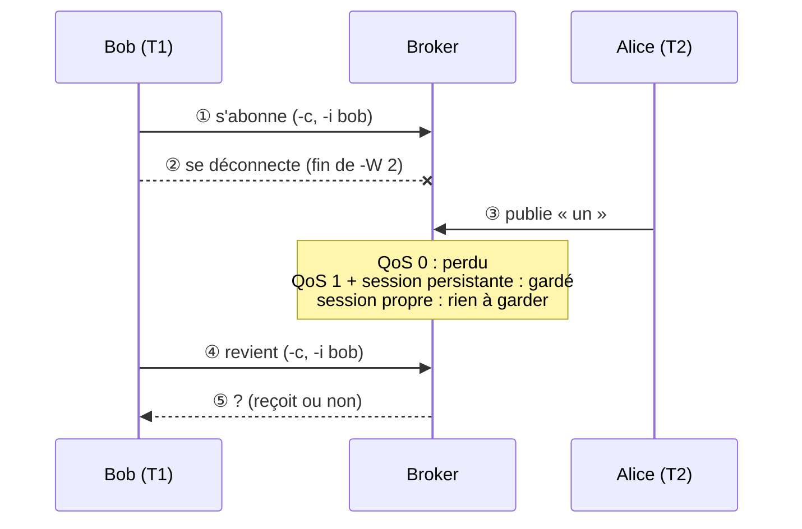

# D03 — MQTT : QoS, session, retain

| | |
|---|---|
| Thématique | [MQTT](../../thematiques/03-mqtt.md) |
| Fallacy | 1 (fiabilité), 2 (latence) |
| Durée | 25 min |
| Matériel | [labo Docker](../infra/README.md), 3 terminaux |
| Théorie | [MQTT](../../supports/mqtt.md) : *QoS*, *Session persistante*, *Retained Messages* |

## But
Prédire puis vérifier qui reçoit quoi quand un abonné est absent.

## 0. Préparation (5 min)

**Démarrer le labo** (une fois, depuis le dossier `activites/infra`, voir [Laboratoire](../infra/README.md)) :

```bash
cd activites/infra
docker compose up -d
docker compose ps        # broker et toxiproxy : "running"
```

**Ouvrir 3 terminaux**, tous dans `activites/infra` :

| Terminal | Rôle |
|---|---|
| `T1` | Bob (l'abonné qui s'absente) |
| `T2` | Alice (qui publie) |
| `T3` | observateur : voit tout ce qui est publié |

Les clients `mosquitto_pub` / `mosquitto_sub` sont **dans le conteneur** du broker : rien à installer. Pour ne pas retaper `docker compose exec broker` à chaque ligne, définissez `DC` dans **chaque** terminal :

```bash
# bash / zsh
alias DC='docker compose exec broker'
```
```powershell
# PowerShell
function DC { docker compose exec broker @args }
```

> **Git Bash sous Windows** : si une commande `docker compose exec` se plaint d'un chemin `C:/Program Files/Git/...`, faites d'abord `export MSYS_NO_PATHCONV=1`.

**Contrôle** : dans `T3` lancez `DC mosquitto_sub -t 'lab/#' -v` (il reste ouvert : `lab/#` = tout ce qui commence par `lab/`, voir [Wildcards](../../supports/mqtt.md#utilisation-des-wildcards)). Dans `T2` : `DC mosquitto_pub -t lab/test -m ok`. Vous devez voir `lab/test ok` dans `T3`. Si oui, le labo marche.

Les options des commandes ci-dessous :

| Option | Sens |
|---|---|
| `-i bob` | identifiant fixe du client (le broker reconnaît Bob) |
| `-c` | session **persistante** : le broker garde l'abonnement et les messages manqués |
| `-q 0\|1` | QoS demandé |
| `-W 2` | s'arrêter après 2 s |
| `-C 1` | s'arrêter après 1 message |
| `-r` | **retain** : le broker garde le dernier message du topic |

## 1. Prédire (5 min, avant de toucher au clavier)

> Théorie : [QoS](../../supports/mqtt.md#qos) · [Session persistante](../../supports/mqtt.md#session-persistante) · [Retained Messages](../../supports/mqtt.md#retained-messages-messages-conserves)

Alice publie **pendant que Bob est déconnecté**. Complétez avec *reçoit / ne reçoit pas* :

| Cas | QoS Alice | QoS Bob | Session Bob | Retain | Bob reçoit en revenant ? |
|---|---|---|---|---|---|
| A | 0 | 0 | persistante | non | ? |
| B | 1 | 1 | persistante | non | ? |
| C | 1 | 1 | **propre** (non persistante) | non | ? |
| D | 0 | 0 | propre | **oui** | ? |

Le schéma de ce que vous allez faire pour les cas A, B et C :



## 2. Vérifier

### Cas A : QoS 0, session persistante

> Théorie : [QoS](../../supports/mqtt.md#qos) (« au plus une fois ») · [Session persistante](../../supports/mqtt.md#session-persistante) (les messages QoS 0 ne sont pas conservés)

1. `T1` : `DC mosquitto_sub -i bob -c -q 0 -t lab/a -W 2`  
   → `Timed out` après 2 s : normal, personne n'a publié. Bob est abonné, puis il se déconnecte.
2. `T2` : `DC mosquitto_pub -q 0 -t lab/a -m un`  
   → `T3` affiche `lab/a un` : Alice a bien publié.
3. `T1` : `DC mosquitto_sub -i bob -c -q 0 -t lab/a -W 3 -v`  
   → **rien** (`Timed out`) : le message QoS 0 est perdu.

### Cas B : QoS 1, session persistante

> Théorie : [QoS](../../supports/mqtt.md#qos) (« au moins une fois ») · [Session persistante](../../supports/mqtt.md#session-persistante)

Mêmes étapes, autre topic (`lab/b`). **À vous de les faire dans l'ordre : `T1` (s'abonner), `T2` (publier), `T1` (revenir).** Première commande :

4. `T1` : `DC mosquitto_sub -i bob -c -q 1 -t lab/b -W 2`
5. `T2` : à vous (publier `deux` sur `lab/b` en QoS 1).
6. `T1` : à vous (revenir avec les mêmes options, plus `-C 1 -W 3 -v`).

<details><summary>Commandes et résultat</summary>

5. `DC mosquitto_pub -q 1 -t lab/b -m deux`
6. `DC mosquitto_sub -i bob -c -q 1 -t lab/b -C 1 -W 3 -v` → `lab/b deux` : le broker l'a gardé pour Bob.
</details>

### Cas C : QoS 1, session propre

> Théorie : [Session persistante](../../supports/mqtt.md#session-persistante) (sans elle, rien n'est gardé)

Même chose sur `lab/c`, mais **sans `-c`** (le broker oublie Bob dès qu'il part) :

7. `T1` : `DC mosquitto_sub -i bob -q 1 -t lab/c -W 2`
8. `T2` : `DC mosquitto_pub -q 1 -t lab/c -m trois`
9. `T1` : `DC mosquitto_sub -i bob -q 1 -t lab/c -C 1 -W 3 -v`  
   → rien reçu : sans session persistante, le broker ne sait plus que Bob était abonné.

### Cas D : retain

> Théorie : [Retained Messages](../../supports/mqtt.md#retained-messages-messages-conserves)

10. `T2` : `DC mosquitto_pub -q 0 -r -t lab/d -m quatre`
11. `T1` (Bob arrive *après*, session propre) : `DC mosquitto_sub -t lab/d -C 1 -W 3 -v`  
    → `lab/d quatre` **immédiatement** : le broker avait gardé le dernier message du topic.
12. Effacez le message retenu : `DC mosquitto_pub -r -n -t lab/d`

## 3. Dégrader le réseau (fallacy 2)

> Théorie : [Fallacy 2 — la latence est nulle](../../supports/fallacies.md#fallacy-2) · [QoS](../../supports/mqtt.md#qos) (le schéma des échanges : chaque accusé est un aller-retour de plus)

Le proxy de pannes (port `1884`) permet d'ajouter de la latence. Chronométrez d'abord une publication **sans** panne, puis **avec**.

```bash
# bash : time ... ; PowerShell : Measure-Command { ... }
time DC mosquitto_pub -h toxiproxy -p 1884 -q 1 -t lab/e -m normal
```

13. Notez la durée (quelques dixièmes de seconde à 2 s : c'est le coût de `docker compose exec`).
14. Activez 2 s de latence : `docker compose exec toxiproxy /toxiproxy-cli toxic add -t latency -a latency=2000 mqtt`
15. Refaites la mesure en **QoS 0**, puis en **QoS 1** (mêmes commandes, `-q 0` puis `-q 1`).  
    → environ **+2 s** en QoS 0 (attente de l'acceptation de la connexion) et environ **+4 s** en QoS 1 (en plus, attente de l'accusé de réception) : QoS 1 attend une confirmation, chaque aller-retour coûte la latence.
16. **Retirez la panne** : `docker compose exec toxiproxy /toxiproxy-cli toxic remove -n latency_downstream mqtt`

## Débrief

- Dans quels cas le « tout va bien » de la fallacy 1 vous a-t-il fait perdre un message **sans erreur visible** ? (regardez `T3` : Alice a publié sans erreur aux cas A et C)
- Votre chat a deux flux : `chat/all` et `chat/dm/<nom>`. Quel QoS pour chacun, et pourquoi ?
- À quoi sert `retain` pour une liste de services ouverts ? Quel danger si un service meurt et que son message retenu reste ?

<details><summary>Solution</summary>

| Cas | Bob reçoit ? |
|---|---|
| A | non (QoS 0 = au plus une fois) |
| B | oui (QoS 1 + session persistante) |
| C | non (pas de session) |
| D | oui, à l'abonnement (retain) |

- Le QoS effectif est le **minimum** entre celui du publieur et celui de l'abonné.
- Chat global : QoS 0 (on tolère une perte). Privé : QoS 1 (mais prévoir les doublons → thématique [Idempotence](../../thematiques/05-idempotence.md)).
- Un retain « ouvert » qui survit à la mort de son auteur ment : d'où le LWT (D04).
</details>

## Pour aller plus loin (optionnel)

Refaites le cas B avec Bob en `-q 0` (Alice reste en `-q 1`, topic `lab/f`) : Bob reçoit-il ? Que dit le « QoS effectif » ? (La suite, la mort d'un client, c'est [D04](D04-mort-noeud.md).)
