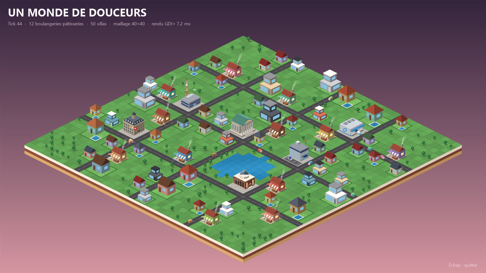

# Fil rouge « UMDD (Un Monde De Douceurs) »

Nous sommes un groupe d'artisans Boulanger-Pâtissier qui bâtissons **Dousville**, la ville de nos rêves, celle des meilleures Boulangeries-Pâtisseries (BP) de tout le cyberspace. L'entrepreneur qui nous a livré le réseau TCP/IP en vante les mérites : voir l'histoire de départ dans [UMDD.md](../../../UMDD.md) et [avant/après](../../../supports/assets/before.png).

Chacune de ses affirmations est l'une des [fallacies](../../../supports/fallacies.md) : **la ville existera quand chacune aura été démentie**. Conseil de l'expert (M. Chad Geppetto) : s'organiser en coopérative, sans croire l'entrepreneur, sur une architecture de microservices.

## Identité du scénario

| | |
|---|---|
| Racine de topics | `dousville/` (`dousville/presence/<bp>`, `dousville/time`, `dousville/log/<bp>`, `dousville/vitrine/<bp>`) |
| Vocabulaire | un nœud est une **BP** (boulangerie-pâtisserie) |
| Types de messages ajoutés | `business` ([schéma](business.schema.json)) |
| Contrat | le [contrat de base](../../contrats/README.md) partagé, plus l'extension ci-dessus |
| Catalogue | [services](../services.md) : source de temps, annuaire, journal, paiement, échange, vitrine, supervision, défi |

## Services de la ville

| Service | Thématique | Qui |
|---|---|---|
| Vitrine / Billboard | [Sérialisation](../../../thematiques/01-serialisation.md) | chacun |
| TimeService | [Temps](../../../thematiques/02-temps.md) | un groupe, avec filet du prof |
| LogService, Annuaire | [Microservices](../../../thematiques/04-microservices.md) | groupes, avec filet du prof |
| Banque, Coopérative (Fair Trade) | [Idempotence](../../../thematiques/05-idempotence.md), [Transactions](../../../thematiques/06-transactions.md) | groupes, avec filet du prof |
| Annuaire en cluster | [Résilience](../../../thematiques/07-resilience.md), [Cluster et P2P](../../../thematiques/08-cluster-p2p.md) | le groupe Annuaire |
| Sécurisation | [Sécurité](../../../thematiques/09-securite.md) | tous |
| Supervision | [Supervision](../../../thematiques/10-supervision.md), [Énergie](../../../thematiques/11-energie.md) | un groupe |
| Défi voté | toutes | tous |

## Règles de la ville

- **Langage libre**, [contrat](../../contrats/README.md) obligatoire. Chaque groupe fait tourner au moins un service dans un langage différent de celui de sa BP.
- **Filet de sécurité.** Pour chaque service partagé le prof fournit un *service de référence* : si un groupe n'a pas livré, la classe n'est pas bloquée. Un service de référence peut être « tué » par l'enseignant pour un exercice de résilience.
- **Réutilisez votre [chat](../../chat/README.md)** : la plomberie (connexion, enveloppe, validation, reconnexion) est la même.
- **Le [labo Docker](../../infra/README.md)** est votre terrain de test : cassez votre ville avant que la classe ne le fasse.
- Le `Front` C# ([activites/umdd](../../umdd/README.md)) est une vitrine **optionnelle**.

## Les étapes de la ville

| Page | Thématique illustrée |
|---|---|
| [Vitrine](vitrine.md) | Sérialisation |
| [TimeService](time.md) | Temps, MQTT |
| [Log et annuaire](log-annuaire.md) | Microservices |
| [Banque et coopérative](banque-coop.md) | Idempotence, Transactions |
| [Annuaire en cluster](cluster.md) | Résilience, Cluster et P2P |
| [Sécurité](securite.md) | Sécurité |
| [Supervision](supervision.md) | Supervision, Énergie |
| [Défi voté](defi.md) | toutes |

## Couverture des exigences

Exigences génériques : [contrat de scénario](../README.md#contrat-de-scenario). UMDD est la référence : c'est de ses DoD que les exigences sont dérivées. Les « manques » sont les points où une page UMDD est en deçà de l'exigence générique.

| Thématique | Page | Couvert par | Manque |
|---|---|---|---|
| Sérialisation | [Vitrine](vitrine.md) | `business` + schéma partagé, vitrine hostile | les trois entrées hostiles ne sont pas listées dans la DoD |
| Temps | [TimeService](time.md) | `dousville/time`, `--clock-skew 30`, mode dégradé | |
| MQTT | [TimeService](time.md), [Vitrine](vitrine.md) | vitrines retenues, arrivée tardive | choix du QoS par flux à demander explicitement |
| Microservices | [Log et annuaire](log-annuaire.md) | LWT, annuaire des BP ouvertes | délai de retrait (10 s) à chiffrer dans la DoD |
| Idempotence | [Banque et coopérative](banque-coop.md) | banque, doublons | borne de la mémoire de déduplication à exiger |
| Transactions | [Banque et coopérative](banque-coop.md) | Fair Trade, panne de la banque | |
| Résilience | [Annuaire en cluster](cluster.md) | retry + backoff + jitter, proxy | |
| Cluster et P2P | [Annuaire en cluster](cluster.md) | quatre instances, perte de trois | |
| Sécurité | [Sécurité](securite.md) | usurpation, rejeu, observateur | |
| Supervision | [Supervision](supervision.md) | moniteur, alertes, clôture | |
| Énergie | [Supervision](supervision.md) | trafic de supervision pour 30 BP | bilan puissance × durée absent : voir le [bilan Powercher](../powercher/README.md#supervision-energie) |

L'ordre dans lequel ces étapes sont abordées est une suggestion du [planning](../../../planning/README.md).
