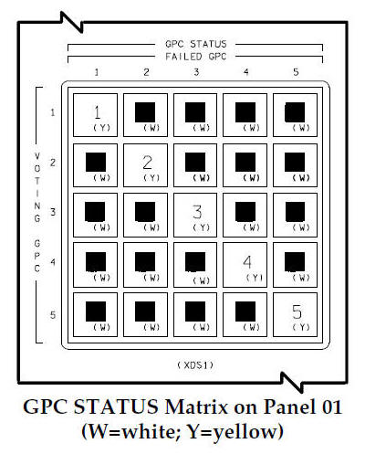

# Cluster

## Load balancing, failover, scalability

  
    Fallacies 1, 5 et 6
  

---

# Plan de la présentation

1. **Cluster** - un service, plusieurs nœuds
2. **Load balancing** - répartir la charge
3. **Failover** - détecter la panne
4. **Scalability** - ajouter des nœuds
5. **Fallacies associées** - le piège et comment l'éviter

---
layout: section
---

# Partie 1
## Le cluster

---

# Un ensemble coordonné

<v-clicks>

- Des nœuds qui coopèrent pour fournir un **service commun**
- Exemple : plusieurs centrales d'énergie, les maisons ne voient qu'**un service**
- Transparent pour l'utilisateur : répartition de charge, redirection d'un travail non terminé, ajout d'un nœud

</v-clicks>

<v-click>

Le plus simple : un cluster <b>sans état</b>, n'importe quel nœud peut répondre.

</v-click>

---
layout: section
---

# Partie 2
## Load balancing

---

# Centralisé ou distribué

### Centralisé

Un *Master* assigne aux *Workers* :

<v-clicks>

- **Round Robin** : chacun son tour
- **Segmentation** : selon le client
- **Least Connections**
- **Least Load**
- **Random**

</v-clicks>

<v-click>

### Distribué

Les tâches sont présentées à tous, chacun « pioche » selon un calcul sur les attributs (**hash-based**).

MQTT 5 : les abonnements partagés donnent un round robin sans master.

</v-click>

---
layout: section
---

# Partie 3
## Failover

---

# Détecter la panne

<v-clicks>

- Centralisé : le Master ajuste sa liste de Workers
- Distribué : chaque nœud restant se reconfigure
- La difficulté : **comment savoir qu'un nœud est mort ?**
- **Heartbeat** : l'absence du signal régulier signifie la mort
- **Timeout** : question sans réponse dans le délai
- **Détection distribuée** : chaque nœud évalue les autres et vote

</v-clicks>

---

# Vote : la navette spatiale

Les ordinateurs de bord de la navette évaluent l'état les uns des autres et votent.

---

# Attention : split brain

<v-clicks>

- Un nœud seulement **coupé** (pas mort) se croit toujours responsable
- Un autre prend sa place : **deux nœuds responsables**
- Service sans état (annuaire) : sans gravité
- Service avec état (banque) : **double effet**

</v-clicks>

<v-click>

D'où l'importance de l'idempotence.

</v-click>

---
layout: section
---

# Partie 4
## Scalability

---

# L'inverse de la panne

<v-clicks>

- On crée le nouveau nœud, sans le problème de détection
- Centralisé : ajuster la liste de Workers du Master
- Distribué : configurer la règle de répartition sur le nouveau nœud et reconfigurer les autres avec la même règle

</v-clicks>

---
layout: section
---

# Fallacies associées
## Le piège et comment l'éviter

---

# Fallacy 5 : la topologie ne change pas

<v-click>

<b>Ce qui arrive :</b> Des nœuds arrivent, partent, changent d'adresse : une adresse écrite en dur devient fausse.

</v-click>

<v-click>

<b>Mieux faire :</b> Découverte (annuaire, présence MQTT), noms logiques, configuration externe, pas d'adresse IP dans le code.

</v-click>

<v-click>

<b>Exemple :</b> Un nœud ajouté au cluster doit être découvert et ajouté à la liste de Workers sans redéployer les clients.

</v-click>

---

# Fallacy 6 : il n'y a qu'un administrateur

<v-click>

<b>Ce qui arrive :</b> Plusieurs équipes déploient à leur rythme avec leurs règles : une modification locale casse les autres.

</v-click>

<v-click>

<b>Mieux faire :</b> Contrats explicites et versionnés, compatibilité ascendante, journaux signés, décisions de confiance documentées.

</v-click>

<v-click>

<b>Exemple :</b> Deux équipes gèrent chacune un nœud avec une configuration différente : le round robin devient imprévisible. Une règle de répartition commune et versionnée l'évite.

</v-click>

---

# Fallacy 1 : le réseau est fiable

<v-click>

<b>Ce qui arrive :</b> Les messages se perdent, se dupliquent, les nœuds meurent sans prévenir.

</v-click>

<v-click>

<b>Mieux faire :</b> Accusés de réception, retries avec backoff, idempotence, LWT et heartbeat pour détecter les morts.

</v-click>

<v-click>

<b>Exemple :</b> Le nœud A est coupé, B prend le relais, A se croit toujours responsable (split brain) : deux débits. Idempotence et identifiants les rendent inoffensifs.

</v-click>

---
layout: center
class: text-center
---

<v-click every=1>
Load balancing, failover et scalability se matérialisent dans un cluster.

  
    Sans état si possible, idempotent sinon
  

# Questions ?

Prochaine étape : P2P

</v-click>
