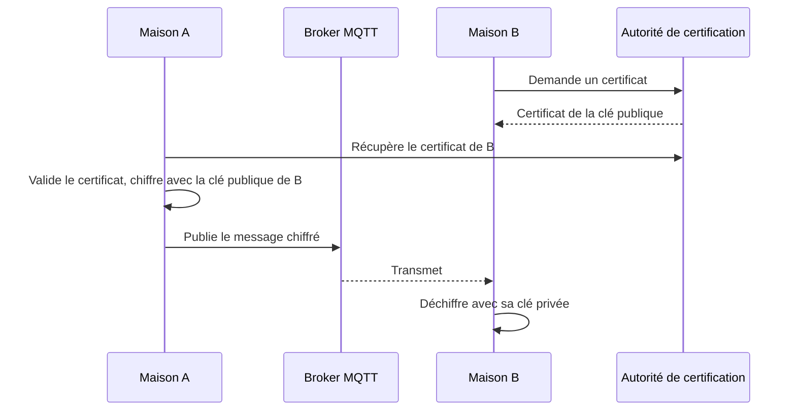
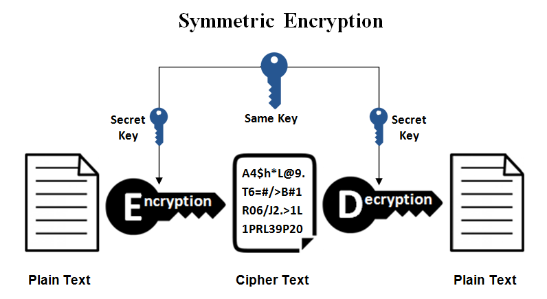

# Confidentialité

## Chiffrer protège la lecture

  
    Fallacy 4 : le réseau est sûr
  

---

# Plan de la présentation

1. **Principes** - chiffrement, authentification, transit
2. **Clés asymétriques** - exemple avec un broker
3. **Clé symétrique** - et approche hybride
4. **Limites**
5. **Fallacies associées** - le piège et comment l'éviter

---
layout: section
---

# Partie 1
## Principes

---

# Seules les entités autorisées lisent

<v-clicks>

1. **Chiffrement avant transmission** : symétrique (une clé) ou asymétrique (paire)
2. **Authentification des parties** : prouver qu'on est autorisé
3. **Protection en transit** : même si le réseau est compromis

</v-clicks>

<v-click>

Même le broker est un intermédiaire à qui on ne fait pas confiance.

</v-click>

---
layout: section
---

# Partie 2
## Clés asymétriques

---

# La maison A écrit à la maison B

<v-clicks>

1. A récupère la clé publique de B et vérifie son certificat
2. A chiffre avec la clé publique de B
3. A s'authentifie au broker et publie le message chiffré
4. Le broker transmet, **sans pouvoir lire**
5. B s'authentifie et déchiffre avec sa clé privée

</v-clicks>

---

# Diagramme de séquence

---
layout: section
---

# Partie 3
## Clé symétrique

---

# Se mettre d'accord sur la clé

<v-clicks>

- Même principe, mais il faut **partager la clé**
- Si elle est compromise, **tout le réseau** l'est
- En pratique : asymétrique pour échanger une clé symétrique, puis symétrique (rapide) pour les données

</v-clicks>

---
layout: section
---

# Partie 4
## Limites

---

# Ce que le chiffrement ne fait pas

<v-clicks>

- Il **ne prouve pas l'auteur** : n'importe qui avec la clé publique de B peut lui écrire, il faut une **signature**
- Il **n'empêche pas le rejeu** : il faut un identifiant et un horodatage
- Le **topic** et les en-têtes (qui parle à qui, quand, combien) restent visibles du broker

</v-clicks>

---
layout: section
---

# Fallacies associées
## Le piège et comment l'éviter

---

# Fallacy 4 : le réseau est sûr

<v-click>

<b>Ce qui arrive :</b> Quelqu'un écoute, modifie ou rejoue les messages ; le broker lui-même est un intermédiaire.

</v-click>

<v-click>

<b>Mieux faire :</b> Chiffrer, signer, inclure identifiant et horodatage dans ce qui est signé, valider les entrées, authentifier les clients.

</v-click>

<v-click>

<b>Exemple :</b> Un message « ouvrir la vanne » intercepté puis rejoué une heure plus tard : sans identifiant ni horodatage signés, il est accepté.

</v-click>

---
layout: center
class: text-center
---

<v-click every=1>
Seul le destinataire lit, même si le réseau ou le broker sont compromis.

  
    Chiffrer protège la lecture, pas l'auteur ni le rejeu
  

# Questions ?

Prochaine étape : réseau de confiance

</v-click>
