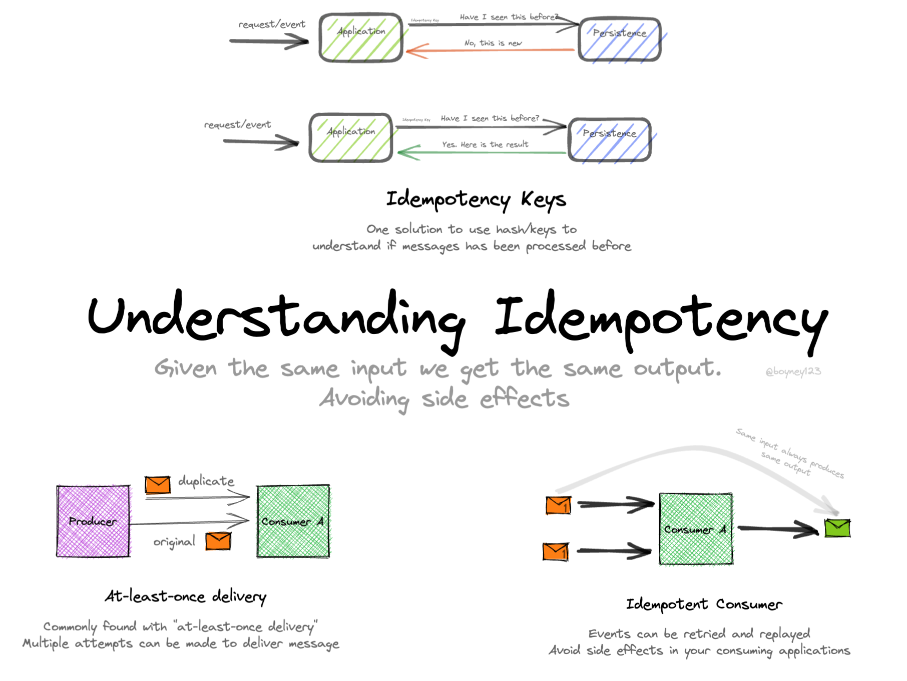

# Idempotence

## Un message peut arriver deux fois

<div class="pt-12">
  <span class="px-2 py-1 rounded bg-blue-500 text-white">
    Fallacy 1 : le réseau est fiable
  </span>
</div>

---
layout: image
image: ./assets/idempotence.png
---

---

# Plan de la présentation

1. **Définition** - même résultat, une ou N fois
2. **Stratégies** - état, identifiant, clé d'idempotence
3. **HTTP** - PUT et POST
4. **Enveloppe** - dédupliquer proprement
5. **Fallacies associées** - le piège et comment l'éviter

---
layout: section
---

# Partie 1
## Définition

---

# Idempotent ou pas ?

| Opération                                   | Idempotente ? |
|---------------------------------------------|---------------|
| `solde = 200` (fixer un état)               | **oui**       |
| `solde += 50` (ajouter une différence)      | **non**       |
| supprimer l'élément 123                     | oui           |
| créer avec identifiant généré par le serveur| non           |

<v-click>
<div class="mt-4 p-3 bg-green-700 rounded text-green-200">
<b>Fixer un état</b> est idempotent, <b>ajouter une différence</b> ne l'est pas.
</div>
</v-click>

<v-click>
<div class="mt-4 p-3 bg-yellow-600 rounded text-yellow-200">
Idempotent ne veut pas dire commutatif : si l'ordre d'arrivée change, le résultat peut changer.
</div>
</v-click>

---

# Le lien avec MQTT

<v-clicks>

- QoS 1 : livraison **au moins une fois**, donc doublons possibles
- Les consommateurs doivent traiter les messages de façon **idempotente**
- QoS 2 limite les doublons entre client et broker, mais pas un renvoi décidé par l'application (timeout, redémarrage)

</v-clicks>

<v-click>
<div class="mt-4 p-3 bg-blue-700 rounded text-blue-300">
Même en QoS 2, l'idempotence reste nécessaire.
</div>
</v-click>

---
layout: section
---

# Partie 2
## Stratégies

---

# Trois stratégies

<v-clicks>

1. **Opération naturellement idempotente** : fixer un état plutôt qu'ajouter une différence
2. **Dédupliquer par identifiant** : UUID unique par message, le consommateur ignore ceux déjà traités
3. **Clé d'idempotence côté client** : un identifiant pour *l'intention* (« créer cette commande »), le serveur refuse la seconde requête

</v-clicks>

---

# Dédupliquer sans se tromper

<v-clicks>

- L'émetteur **réutilise le même identifiant** à chaque retransmission
- La liste des identifiants vus est **purgée** : garder au moins la durée maximale de redélivrance (ex. 24 h)

</v-clicks>

<v-click>
<div class="mt-4 p-3 bg-red-700 rounded text-red-100">
Piège : un UUID généré à chaque envoi. Chaque essai porte un nouvel identifiant, la déduplication ne reconnaît rien. L'identifiant se fixe à la <b>création</b> du message.
</div>
</v-click>

---
layout: section
---

# Partie 3
## HTTP : PUT et POST

---

# PUT contre POST

| Aspect              | POST                       | PUT                                     |
|---------------------|----------------------------|-----------------------------------------|
| Idempotence         | non                        | oui                                     |
| Usage               | créer une ressource        | créer ou remplacer à une adresse précise|
| Si répété           | plusieurs ressources       | toujours le même état                   |
| Identifiant         | généré par le serveur      | **fourni par le client**                |

```text
POST /api/items       {"name":"item1","value":100}   →  nouvel identifiant à chaque appel
PUT  /api/items/123   {"name":"item1","value":100}   →  même état, quel que soit le nombre d'appels
```

---

# Sécuriser un POST

<v-clicks>

- Joindre un **identifiant unique** (corps ou en-tête), mémorisé par le serveur
- Seconde requête identique : refus (**409 Conflict**) ou résultat de la première
- Variante : demander d'abord un identifiant au serveur, puis créer avec PUT

</v-clicks>

<v-click>
<div class="mt-4 p-3 bg-blue-800 rounded text-blue-100">
POST quand le serveur contrôle l'identifiant, PUT quand le client contrôle la ressource visée.
</div>
</v-click>

---
layout: section
---

# Partie 4
## Enveloppe de message

---

# Séparer technique et métier

<div class="grid grid-cols-2 gap-6">
<div>

<v-clicks>

- Une **enveloppe** : identifiant unique, émetteur, destinataire, type, contenu
- Le consommateur mémorise les identifiants traités
- Combinée aux **retries** et aux **transactions**

</v-clicks>

</div>
<div>



</div>
</div>

---
layout: section
---

# Fallacies associées
## Le piège et comment l'éviter

---

# Fallacy 1 : le réseau est fiable

<v-click>
<div class="mt-1 p-3 bg-red-700 rounded text-red-100">
<b>Ce qui arrive :</b> Les messages se perdent, se dupliquent, les nœuds meurent sans prévenir.
</div>
</v-click>

<v-click>
<div class="mt-2 p-3 bg-green-700 rounded text-green-200">
<b>Mieux faire :</b> Accusés de réception, retries avec backoff, idempotence, LWT et heartbeat pour détecter les morts.
</div>
</v-click>

<v-click>
<div class="mt-2 p-3 bg-blue-800 rounded text-blue-100">
<b>Exemple :</b> Le client ne reçoit pas la réponse et renvoie « créer commande ». PUT avec identifiant client, ou clé d'idempotence sur le POST.
</div>
</v-click>

---
layout: center
class: text-center
---

<v-click every=1>
L'idempotence rend les retransmissions inoffensives.

<div class="pt-12 mb-4">
  <span class="px-4 py-2 rounded bg-blue-500 text-white text-xl">
    Fixer un état, identifier chaque message
  </span>
</div>

# Questions ?

<div class="mt-8 text-gray-500">

Prochaine étape : les transactions

</div>
</v-click>
