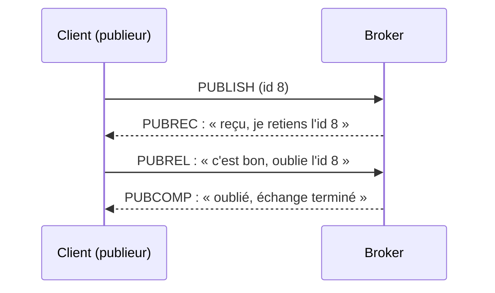

# MQTT

## Un bus léger, des garanties à choisir

  
    Fallacies 1 et 2
  

---
layout: image
image: ./assets/mqtt.jpg
---

---

# Plan de la présentation

1. **Principe** - broker, topics, wildcards
2. **Livraison** - QoS et session persistante
3. **Présence** - retain, LWT, keep-alive
4. **Options** - bufferisation, NoLocal, abonnements partagés
5. **Fallacies associées** - le piège et comment l'éviter

---
layout: section
---

# Partie 1
## Publish-subscribe

---

# Le broker au centre

<v-clicks>

- Conçu pour l'IoT : peu de ressources, **connexions instables**, faible bande passante
- Les clients ne se parlent pas : ils passent par le **broker** (TCP/IP)
- Ils **publient** sur des **topics**, d'autres **s'abonnent**
- Topics hiérarchiques séparés par `/` : `maison/salon/temperature`

</v-clicks>

---

# Wildcards

<v-clicks>

- `+` remplace **un** niveau : `maison/+/temperature` = la température de toutes les pièces
- `#` remplace **plusieurs** niveaux, en fin de filtre : `maison/#` = tout sur la maison

</v-clicks>

<v-click>

MQTT ne garantit rien de plus que ce qu'on lui demande : <b>QoS</b> (livraison), <b>session</b> (absence), <b>retain</b> (arrivée tardive), <b>LWT</b> (mort).

</v-click>

---
layout: section
---

# Partie 2
## Livraison

---

# Qualité de service

| QoS | Garantie                      | Coût                  | Conséquence                                |
|-----|-------------------------------|-----------------------|--------------------------------------------|
| 0   | au plus une fois              | le plus léger         | un message peut se perdre                  |
| 1   | **au moins une fois**         | un accusé (PUBACK)    | **doublons** possibles, donc idempotence   |
| 2   | exactement une fois           | 4 messages d'échange  | le plus lent                               |

<v-click>

Le QoS effectif est le <b>minimum</b> entre celui du publieur et celui de l'abonné.

</v-click>

---

# QoS 2 : l'échange en 4 temps

<v-click>

Retenir l'identifiant permet d'écarter un PUBLISH renvoyé : <b>exactement une fois</b>, au prix de deux allers-retours.

</v-click>

---

# Session persistante

<v-clicks>

- Identifiant client stable, session non « propre »
- Le broker conserve les **abonnements** et les messages **QoS 1 et 2** non délivrés
- Remise à la reconnexion : utile pour les capteurs sur batterie
- Les messages QoS 0 ne sont **pas** conservés

</v-clicks>

---
layout: section
---

# Partie 3
## Présence

---

# Retained messages

<v-clicks>

- Le broker garde le **dernier** message retenu d'un topic
- Il le remet **immédiatement** à tout nouvel abonné : idéal pour un état courant
- Effacer : publier un contenu **vide** avec retain

</v-clicks>

<v-click>

Un état retenu peut <b>mentir</b> : le client est mort, son dernier message dit encore « ouvert ». Correction : un LWT retenu.

</v-click>

---

# Last Will and Testament

<v-clicks>

- À sa connexion, le client dépose chez le broker un message « testament » (topic, contenu, QoS, retain)
- Déconnexion **propre** (`DISCONNECT`) : testament **non** publié
- Déconnexion **anormale** (réseau, courant, processus tué) : le **broker** publie le testament

</v-clicks>

<v-click>

C'est le broker qui publie, pas le client : voilà pourquoi cela marche quand le client ne peut plus rien faire. Le contenu, horodatage compris, est figé à la connexion.

</v-click>

---

# Keep-Alive

<v-clicks>

- Intervalle fixé par le client : s'il n'envoie rien, il envoie un `PINGREQ`, le broker répond `PINGRESP`
- Rien reçu pendant **1,5 × Keep-Alive** : le broker déclare le client mort, ferme et publie son LWT
- Compromis : un keep-alive court détecte vite une **mort silencieuse**, mais coûte du trafic et de l'énergie

</v-clicks>

---
layout: section
---

# Partie 4
## Options

---

# Bufferisation, NoLocal, partage

<v-clicks>

- **Bufferisation** : file locale de messages à émettre pendant une coupure, avec une **taille maximale**
- **NoLocal** (MQTT 5) : ne pas recevoir ses propres messages, typique de deux brokers en pont
- **Abonnements partagés** (MQTT 5) : `$share/<groupe>/<topic>`, chaque message n'arrive que chez un membre du groupe

</v-clicks>

<v-click>

Les abonnements partagés donnent répartition de charge et failover intégrés.

</v-click>

---
layout: section
---

# Fallacies associées
## Le piège et comment l'éviter

---

# Fallacy 1 : le réseau est fiable

<v-click>

<b>Ce qui arrive :</b> Les messages se perdent, se dupliquent, les nœuds meurent sans prévenir.

</v-click>

<v-click>

<b>Mieux faire :</b> Accusés de réception, retries avec backoff, idempotence, LWT et heartbeat pour détecter les morts.

</v-click>

<v-click>

<b>Exemple :</b> Un capteur meurt : son dernier état retenu dit encore « ouvert ». Un LWT retenu publie « fermé » à sa place.

</v-click>

---

# Fallacy 2 : la latence est nulle

<v-click>

<b>Ce qui arrive :</b> Les temps de réponse varient et explosent : un appel synchrone bloque l'appelant, des timeouts mal réglés propagent la panne.

</v-click>

<v-click>

<b>Mieux faire :</b> Timeouts explicites, communication asynchrone, regrouper les appels, pas d'appel réseau dans une boucle.

</v-click>

<v-click>

<b>Exemple :</b> Un flux de mesures très fréquent en QoS 2 paie quatre messages par échange : choisir QoS 0 pour la mesure, QoS 1 ou 2 pour la commande.

</v-click>

---
layout: center
class: text-center
---

<v-click every=1>
Chaque garantie a un prix et une limite.

  
    Choisir le QoS par flux, retenir les états, pas les événements
  

# Questions ?

Prochaine étape : les microservices

</v-click>
