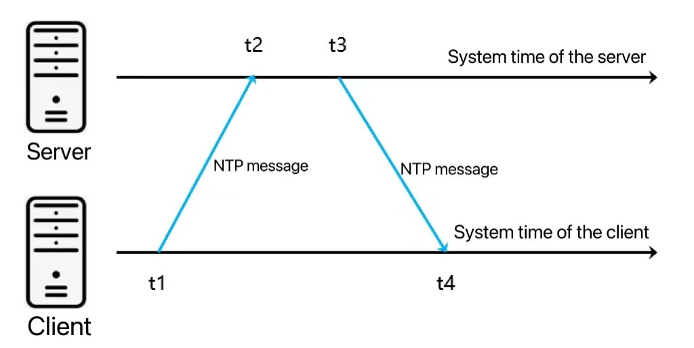
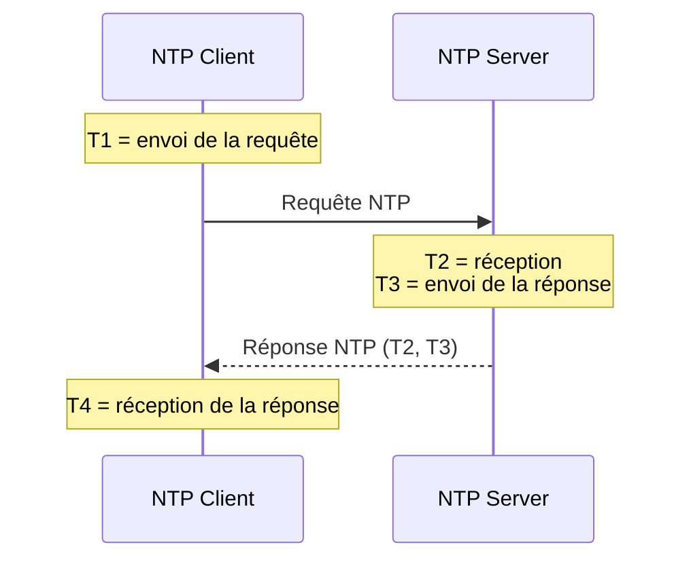

# NTP et le temps

## Des horloges qui dérivent et se contredisent

<div class="pt-12">
  <span class="px-2 py-1 rounded bg-blue-500 text-white">
    Fallacy : chacun connaît l'heure avec précision
  </span>
</div>

---

# Plan de la présentation

1. **Le problème** - l'ordre des événements
2. **NTP et PTP** - synchroniser les horloges
3. **Calcul** - offset et delay
4. **Horloges logiques** - Lamport
5. **Tester** - injecter l'horloge
6. **Fallacies associées** - le piège et comment l'éviter

---
layout: section
---

# Partie 1
## Le problème

---

# Sans heure cohérente

<div class="grid grid-cols-2 gap-6">
<div>

<v-clicks>

- On ne sait plus dans **quel ordre** les événements ont eu lieu
- Un événement futur semble s'être produit avant un événement passé
- Touche : bases distribuées, transactions, corrélation de journaux

</v-clicks>

</div>
<div>



</div>
</div>

<v-click>
<div class="mt-4 p-3 bg-blue-700 rounded text-blue-300">
NTP rapproche les horloges (≈ ms), il ne les rend jamais identiques.
</div>
</v-click>

---
layout: section
---

# Partie 2
## NTP et PTP

---

# Strates NTP

<v-clicks>

- NTP ajuste **progressivement** l'horloge locale sur des serveurs de temps
- Il tient compte de la latence et de sa variabilité
- **Stratum 0** : source primaire (horloge atomique, GPS)
- **Stratum 1** : serveurs reliés à une source
- **Stratum 2** : clients de stratum 1, etc.
- Précision typique : **la milliseconde**

</v-clicks>

---

# NTP ou PTP ?

|             | **NTP**                | **PTP**                      |
|-------------|------------------------|------------------------------|
| Précision   | millisecondes          | microsecondes à nanosecondes |
| Conception  | réseau global          | réseau local, haute précision|
| Délais      | tolère l'imprévisible  | réseau local contrôlé        |
| Matériel    | logiciel               | support matériel nécessaire  |
| Usage       | serveurs, bases, logs  | systèmes critiques           |

<v-click>
<div class="mt-4 p-3 bg-green-700 rounded text-green-200">
Si la milliseconde suffit : NTP. Sinon PTP.
</div>
</v-click>

---
layout: section
---

# Partie 3
## Offset et delay

---

# L'échange NTP



---

# Les formules

<v-clicks>

- **Offset** (décalage du client) : `((T2 − T1) + (T3 − T4)) / 2`, positif = client en retard
- **Delay** (aller-retour sur le réseau) : `(T4 − T1) − (T3 − T2)`

</v-clicks>

<v-click>
<div class="mt-4 p-3 bg-blue-800 rounded text-blue-100">
Exemple : <code>T2 − T1 = +5 ms</code> et <code>T3 − T4 = −3 ms</code> donnent un offset de (5 − 3) / 2 = <b>+1 ms</b>.
</div>
</v-click>

<v-click>
<div class="mt-4 p-3 bg-yellow-600 rounded text-yellow-200">
L'offset suppose un aller et un retour de même durée. Le delay ne corrige pas l'horloge : il mesure la <b>confiance</b> dans l'offset (erreur possible jusqu'à delay / 2).
</div>
</v-click>

---

# Astuce : les timestamps

<v-clicks>

- Convertir toutes les dates en **timestamps** (ms depuis le 1er janvier 1970 UTC)
- Plus de fuseaux, de formats ni d'unités à jongler
- Transmettre et stocker en **UTC**, ne convertir qu'à l'affichage

</v-clicks>

---
layout: section
---

# Partie 4
## Horloges logiques

---

# Algorithme de Lamport

Quand l'**ordre** compte mais pas l'heure exacte. Chaque nœud tient un compteur :

<v-clicks>

1. À chaque événement local et à chaque **envoi** : incrémenter et estampiller le message
2. À chaque **réception** : `max(compteur local, estampille reçue) + 1`

</v-clicks>

<v-click>
<div class="mt-4 p-3 bg-green-700 rounded text-green-200">
Si un message en a provoqué un autre, le premier a une estampille plus petite (ordre causal).
</div>
</v-click>

<v-click>
<div class="mt-4 p-3 bg-red-700 rounded text-red-100">
Deux événements sans lien peuvent être ordonnés arbitrairement. L'estampille ne dit rien de l'heure réelle : jamais pour facturer.
</div>
</v-click>

---
layout: section
---

# Partie 5
## Tester le temps

---

# Injecter l'horloge

```text
programme(horloge)          # l'horloge est un paramètre
    maintenant = horloge.instant_actuel()
    si maintenant < 1er janvier 2024 : "avant"  sinon : "après"

production : programme(horloge_système)
test       : programme(horloge_factice(31 déc. 2023, 23h59))
             horloge_factice.avancer(2 minutes)
```

<v-click>
<div class="mt-4 p-3 bg-blue-700 rounded text-blue-300">
On teste des dates et des délais sans attendre. Bibliothèques : Joda-Time (Java), NodaTime et <code>FakeClock</code> (C#).
</div>
</v-click>

---
layout: section
---

# Fallacies associées
## Le piège et comment l'éviter

---

# Neuvième fallacy : chacun connaît l'heure avec précision

<v-click>
<div class="mt-1 p-3 bg-red-700 rounded text-red-100">
<b>Ce qui arrive :</b> Les horloges dérivent et se contredisent : un événement futur semble précéder un événement passé, les journaux ne se corrèlent plus.
</div>
</v-click>

<v-click>
<div class="mt-2 p-3 bg-green-700 rounded text-green-200">
<b>Mieux faire :</b> Synchroniser avec NTP (ms) ou PTP, transmettre en UTC, utiliser Lamport quand seul l'ordre compte, injecter l'horloge dans le code pour le tester.
</div>
</v-click>

<v-click>
<div class="mt-2 p-3 bg-blue-800 rounded text-blue-100">
<b>Exemple :</b> Deux nœuds écartés de 4 s : une réponse semble arriver avant la question. Avec une estampille de Lamport, l'ordre causal reste respecté.
</div>
</v-click>

---

# Fallacy 2 : la latence est nulle

<v-click>
<div class="mt-1 p-3 bg-red-700 rounded text-red-100">
<b>Ce qui arrive :</b> Les temps de réponse varient et explosent : un appel synchrone bloque l'appelant, des timeouts mal réglés propagent la panne.
</div>
</v-click>

<v-click>
<div class="mt-2 p-3 bg-green-700 rounded text-green-200">
<b>Mieux faire :</b> Timeouts explicites, communication asynchrone, regrouper les appels, pas d'appel réseau dans une boucle.
</div>
</v-click>

<v-click>
<div class="mt-2 p-3 bg-blue-800 rounded text-blue-100">
<b>Exemple :</b> Un service appelle 50 fois un voisin à 100 ms : 5 s. Un seul appel groupé ou un message asynchrone : 100 ms.
</div>
</v-click>

---
layout: center
class: text-center
---

<v-click every=1>
NTP réduit les écarts, Lamport garantit un ordre cohérent malgré eux : les deux se complètent.

<div class="pt-12 mb-4">
  <span class="px-4 py-2 rounded bg-blue-500 text-white text-xl">
    Prévoir le temps dès la conception
  </span>
</div>

# Questions ?

<div class="mt-8 text-gray-500">

Prochaine étape : MQTT

</div>
</v-click>
