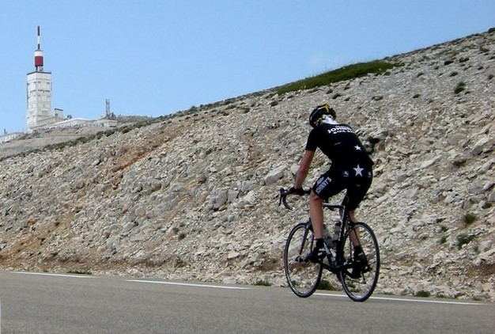
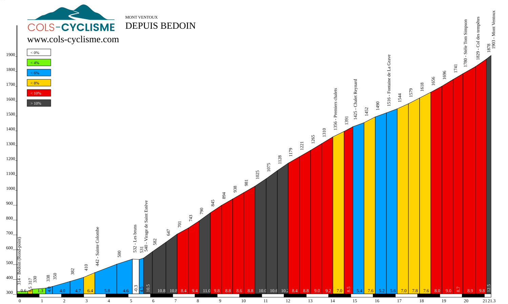

# Puissance et énergie

## La fréquence compte autant que l'intensité

  
    Fallacy 7 : le transport est gratuit
  

---

# Plan de la présentation

1. **Puissance** - le Mont Ventoux
2. **Énergie** - puissance × durée
3. **Système distribué** - batteries et messages
4. **Fallacies associées** - le piège et comment l'éviter

---
layout: section
---

# Partie 1
## Puissance

---

# Un cycliste au Ventoux

<v-clicks>

- Pente d'environ 10 %
- À 15 km/h : environ **330 watts**
- La puissance se mesure en **watts** `[W]`, de manière **instantanée**

</v-clicks>

---
layout: section
---

# Partie 2
## Énergie

---

# Tenir 21 km

<v-clicks>

- 21 km à 15 km/h = 1,4 h
- 330 W = 0,33 kW
- 1,4 × 0,33 = **0,462 kWh**

</v-clicks>

<v-click>

<b>énergie [kWh] = puissance [kW] × durée [h]</b>

</v-click>

---

# Et la douche ?

<v-clicks>

- Douche de 10 minutes chauffée à l'électricité
- Environ **2,5 kWh**, soit plus de cinq fois la montée du Ventoux

</v-clicks>

---
layout: section
---

# Partie 3
## Dans un système distribué

---

# Batterie et messages

<v-clicks>

- Énergie de la batterie : capacité (Ah) × tension (V) = Wh. Exemple : 2 Ah × 3,7 V = **7,4 Wh**
- Autonomie = énergie de la batterie / puissance moyenne
- La puissance moyenne dépend de la **fréquence d'envoi** : chaque message sorti de la veille coûte
- Keep-alive court, heartbeat rapproché, sondage fréquent : des messages « pour rien » qui épuisent l'appareil
- Nœud producteur et consommateur : **bilan énergétique** = Σ durée × puissance (producteurs) moins (consommateurs)

</v-clicks>

<v-click>

Un appareil qui consomme presque rien peut vider une batterie s'il agit trop souvent.

</v-click>

---
layout: section
---

# Fallacies associées
## Le piège et comment l'éviter

---

# Fallacy 7 : le transport est gratuit

<v-click>

<b>Ce qui arrive :</b> Chaque message coûte du temps, de l'énergie et de l'argent : les messages « pour rien » épuisent les batteries et la facture.

</v-click>

<v-click>

<b>Mieux faire :</b> Mesurer, grouper les envois, espacer les heartbeats, calculer l'autonomie avant de choisir une fréquence.

</v-click>

<v-click>

<b>Exemple :</b> Un capteur sur batterie de 7,4 Wh qui envoie chaque seconde se vide en quelques jours : espacer et grouper multiplie l'autonomie.

</v-click>

---
layout: center
class: text-center
---

<v-click every=1>
La puissance est instantanée, l'énergie intègre la durée.

  
    Espacer, grouper, mesurer
  

# Questions ?
</v-click>
