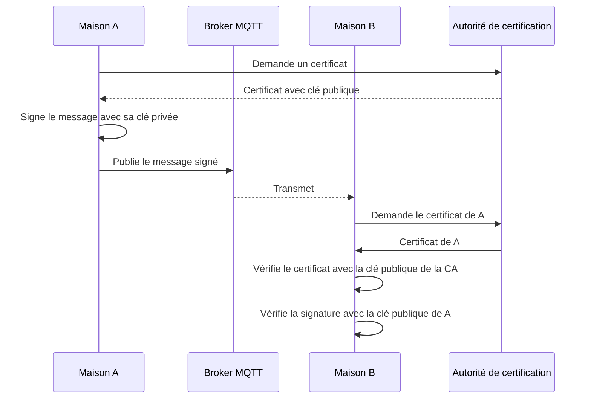

# Réseau de confiance

## Identité et validité

  
    Fallacies 4 et 6
  

---
layout: image
image: ./assets/confiance.jpg
---

---

# Plan de la présentation

1. **Deux aspects** - identité, validité
2. **PKI** - signer les messages MQTT
3. **Défis** - certificats, latence, confiance initiale
4. **Dans ce module**
5. **Fallacies associées** - le piège et comment l'éviter

---
layout: section
---

# Partie 1
## Deux aspects fondamentaux

---

# Identité

<v-clicks>

- Le récepteur est certain de l'identité de l'émetteur
- L'émetteur ne peut pas nier : **non-répudiation**, architecture **PKI**
- **Certificats** émis par une autorité centrale ou décentralisée
- **Propagation** de la confiance : directe (A connaît B) ou transitive (A fait confiance à B, qui fait confiance à C)
- **Validation mutuelle** avant de partager

</v-clicks>

---

# Validité

<v-clicks>

- Une identité vérifiée ne dit pas que les actions **respectent les règles**
- Contrôle, traçabilité, éventuellement consensus distribué
- **Logging** centralisé dans un microservice, messages de log **signés** avec la clé privée de l'émetteur

</v-clicks>

<v-click>

Une signature répond à « qui est-ce ? », pas à « a-t-il le droit ? ».

</v-click>

---
layout: section
---

# Partie 2
## PKI et MQTT

---

# Signer les messages

<v-clicks>

1. **Confiance** : chaque maison obtient un certificat X.509 auprès d'une CA
2. **Signature** : message publié accompagné de la signature de son contenu (clé privée)
3. **Vérification** : les abonnés utilisent la clé publique du certificat : origine et données non modifiées
4. **Fichiers volumineux** : hacher (SHA-256), signer le hash

</v-clicks>

---

# Diagramme de séquence

---
layout: section
---

# Partie 3
## Défis

---

# Défis et pistes

| Défi                       | Problème                                  | Piste                                       |
|----------------------------|-------------------------------------------|---------------------------------------------|
| **Gestion des certificats**| distribution et **révocation**            | vérifier par un protocole comme **OCSP**    |
| **Latence et surcoût**     | la cryptographie ajoute de la latence     | ECDSA plutôt que RSA, puces TPM             |
| **Confiance initiale**     | pas de point central fort                 | autorité initiale décentralisée, blockchain |

---

# Dans ce module

<v-clicks>

- Pas d'autorité de certification officielle
- La classe **décide ensemble** qui atteste de l'identité de qui (annuaire ? enseignant ? accord de la classe ?)
- Et ce qui se passe quand une clé fuit

</v-clicks>

<v-click>

C'est exactement le problème de la confiance initiale.

</v-click>

---
layout: section
---

# Fallacies associées
## Le piège et comment l'éviter

---

# Fallacy 4 : le réseau est sûr

<v-click>

<b>Ce qui arrive :</b> Quelqu'un écoute, modifie ou rejoue les messages ; le broker lui-même est un intermédiaire.

</v-click>

<v-click>

<b>Mieux faire :</b> Chiffrer, signer, inclure identifiant et horodatage dans ce qui est signé, valider les entrées, authentifier les clients.

</v-click>

<v-click>

<b>Exemple :</b> Un pair malveillant publie au nom d'un autre. Signature avec clé privée et certificat vérifié : l'imposteur est rejeté.

</v-click>

---

# Fallacy 6 : il n'y a qu'un administrateur

<v-click>

<b>Ce qui arrive :</b> Plusieurs équipes déploient à leur rythme avec leurs règles : une modification locale casse les autres.

</v-click>

<v-click>

<b>Mieux faire :</b> Contrats explicites et versionnés, compatibilité ascendante, journaux signés, décisions de confiance documentées.

</v-click>

<v-click>

<b>Exemple :</b> Qui atteste de l'identité de qui ? La classe décide ensemble et documente ce qui se passe quand une clé fuit.

</v-click>

---
layout: center
class: text-center
---

<v-click every=1>
Deux questions distinctes : l'identité et la validité.

  
    Signer prouve l'identité, pas le droit d'agir
  

# Questions ?

Prochaine étape : monitoring

</v-click>
