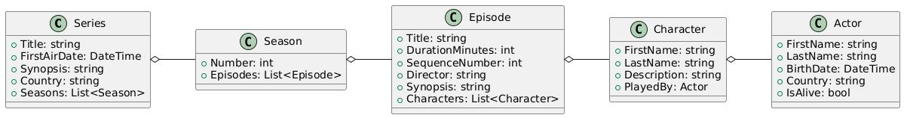

# Sérialisation

## Un format est un contrat

<div class="pt-12">
  <span class="px-2 py-1 rounded bg-blue-500 text-white">
    Fallacies 3 et 8
  </span>
</div>

---

# Plan de la présentation

1. **Principe** - sérialiser, désérialiser
2. **Formats** - texte ou binaire
3. **Défis** - dates, versions, sécurité, performance
4. **Pratique** - constructeurs et champs sensibles
5. **Fallacies associées** - le piège et comment l'éviter

---
layout: section
---

# Partie 1
## Le principe

---

# Pourquoi sérialiser ?

<v-clicks>

- Les composants d'un système distribué **ne partagent aucune mémoire**
- Un objet en mémoire doit devenir une **séquence d'octets** pour être transmis ou stocké
- L'opération inverse est la **désérialisation** (*unmarshalling*)
- Aussi utile pour **sauvegarder l'état** et pour l'**interopérabilité**

</v-clicks>

<v-click>
<div class="mt-4 p-3 bg-blue-700 rounded text-blue-300">
Sérialiser = transformer un objet en octets que <b>d'autres programmes, dans d'autres langages</b>, pourront relire.
</div>
</v-click>

---

# Un exemple

<div class="grid grid-cols-2 gap-6">
<div>



</div>
<v-click>
<div>

```json
{
  "FirstName": "Jennifer",
  "LastName": "Aniston",
  "BirthDate": "1969-02-11T00:00:00",
  "Country": "USA",
  "IsAlive": true
}
```

Le récepteur **désérialise** pour recréer l'objet dans *sa* mémoire, quel que soit son langage.

</div>
</v-click>
</div>

---
layout: section
---

# Partie 2
## Les formats

---

# Texte ou binaire

<v-clicks>

- **Texte** : JSON (simple, omniprésent dans REST), XML (extensible, plus lourd)
- **Binaire** : Protocol Buffers, Avro, MessagePack (compacts et rapides)

</v-clicks>

<v-click>

|                      | Texte (JSON, XML)               | Binaire (Protobuf, MessagePack…) |
|----------------------|---------------------------------|----------------------------------|
| Lisibilité, débogage | **lisible par un humain**       | illisible sans outil ni schéma   |
| Taille               | plus volumineux                 | plus compact                     |
| Vitesse              | plus lent                       | plus rapide                      |
| Interopérabilité     | immédiate                       | exige de partager un schéma      |

</v-click>

<v-click>
<div class="mt-4 p-3 bg-yellow-600 rounded text-yellow-200">
Le binaire compact n'est <b>pas auto-descriptif</b> : sans le schéma, impossible de le lire. À mesurer dans le drill D01.
</div>
</v-click>

---
layout: section
---

# Partie 3
## Défis et limites

---

# Dates, versions, sécurité

<v-clicks>

- **Dates et heures** : se mettre d'accord ; standard **ISO 8601**, en **UTC** pour les échanges
- **Évolution** : versionner, ne **jamais renommer** un champ sans prévenir, champs **optionnels**
- **Sécurité** : désérialiser des données externes est risqué, **valider** contre un schéma
- **Performance** : le texte génère plus de données ; une image en base64 grossit d'un tiers

</v-clicks>

<v-click>
<div class="mt-4 p-3 bg-green-700 rounded text-green-200">
Strict en émission, tolérant en réception.
</div>
</v-click>

---

# Constructeurs et champs sensibles

<v-clicks>

- Le désérialiseur doit savoir **comment** recréer l'objet (constructeur à désigner si plusieurs)
- Mot de passe, jeton, clé d'API : **exclure explicitement** du format

</v-clicks>

<v-click>

| Langage / bibliothèque | Désigner le constructeur               | Exclure un champ         |
|------------------------|----------------------------------------|--------------------------|
| C# `System.Text.Json`  | `[JsonConstructor]`                    | `[JsonIgnore]`           |
| Java Jackson           | `@JsonCreator`                         | `@JsonIgnore`            |
| JavaScript             | `reviver`                              | `toJSON()` ou `replacer` |
| Python                 | `dataclasses` / `pydantic`             | `pydantic` : `exclude`   |

</v-click>

---
layout: section
---

# Fallacies associées
## Le piège et comment l'éviter

---

# Fallacy 3 : la bande passante est infinie

<v-click>
<div class="mt-1 p-3 bg-red-700 rounded text-red-100">
<b>Ce qui arrive :</b> Un format verbeux ou un envoi trop fréquent sature le lien partagé : messages en retard, pertes, facture de données qui explose.
</div>
</v-click>

<v-click>
<div class="mt-2 p-3 bg-green-700 rounded text-green-200">
<b>Mieux faire :</b> Mesurer la taille des messages, choisir un format compact si le volume le justifie, n'envoyer que ce qui a changé, éviter les images en base64.
</div>
</v-click>

<v-click>
<div class="mt-2 p-3 bg-blue-800 rounded text-blue-100">
<b>Exemple :</b> Un capteur envoie 20 champs JSON chaque seconde. Passer à 3 champs utiles toutes les 10 s divise le trafic par plus de 60 (voir drill D01).
</div>
</v-click>

---

# Fallacy 8 : le réseau est homogène

<v-click>
<div class="mt-1 p-3 bg-red-700 rounded text-red-100">
<b>Ce qui arrive :</b> Chaque équipe a son langage, ses versions, ses conventions de dates : un message valide pour l'une est illisible pour l'autre.
</div>
</v-click>

<v-click>
<div class="mt-2 p-3 bg-green-700 rounded text-green-200">
<b>Mieux faire :</b> Format ouvert, contrat écrit (JSON Schema), dates en ISO 8601 UTC, versionner, ne jamais renommer un champ sans prévenir.
</div>
</v-click>

<v-click>
<div class="mt-2 p-3 bg-blue-800 rounded text-blue-100">
<b>Exemple :</b> Renommer <code>BirthDate</code> en <code>birth_date</code> casse tous les consommateurs. Ajouter un champ optionnel ne casse rien.
</div>
</v-click>

---
layout: center
class: text-center
---

<v-click every=1>
Le format est un contrat : le modifier sans prévenir casse les autres.

<div class="pt-12 mb-4">
  <span class="px-4 py-2 rounded bg-blue-500 text-white text-xl">
    Valider tout ce qui entre, ne renommer rien en silence
  </span>
</div>

# Questions ?

<div class="mt-8 text-gray-500">

Prochaine étape : le temps (NTP)

</div>
</v-click>
