# Transactions

## Cohérence à terme, compensations

<div class="pt-12">
  <span class="px-2 py-1 rounded bg-blue-500 text-white">
    Fallacies 1 et 6
  </span>
</div>

---

# Plan de la présentation

1. **ACID** - propriétés d'une transaction
2. **Distribué** - coordinateur et 2PC
3. **Sagas** - compensations et pivot
4. **Idempotence** - reprise après échec
5. **Choisir** - comparaison et recommandations
6. **Faire évoluer le contrat** - pourquoi la saga impose une v3
7. **Fallacies associées** - le piège et comment l'éviter

<div class="mt-6 p-3 bg-blue-800 rounded text-blue-100">
Fil rouge : <b>El Choco</b>. Une visiteuse commande du chocolat, une maison le fabrique, un livreur l'apporte, la banque encaisse.
</div>

---
layout: section
---

# Partie 1
## ACID

---

# Qu'est-ce qu'une transaction ?

Une unité logique de travail, selon les propriétés **ACID** :

<v-clicks>

1. **Atomicité** : tout réussit ou tout échoue
2. **Cohérence** : l'état reste valide avant et après
3. **Isolation** : invisible aux autres avant le *commit*
4. **Durabilité** : l'effet est permanent, même en cas de panne

</v-clicks>

<v-click>
<div class="mt-4 p-3 bg-yellow-600 rounded text-yellow-200">
Entre deux services indépendants, pas d'atomicité « gratuite ». Le pire n'est pas l'échec, c'est le <b>résultat inconnu</b>.
</div>
</v-click>

---

# El Choco : qui participe ?

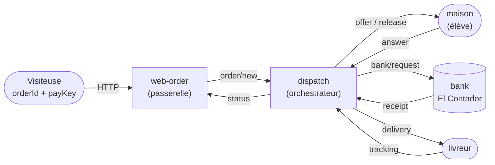

<v-click>
<div class="mt-2 p-2 bg-blue-800 rounded text-blue-100">
Rectangles = <b>services</b> (un seul, état partagé). Ovales = <b>acteurs</b> (plusieurs, au bord du système). Trois participants qui peuvent chacun dire non : maison, banque, livreur.
</div>
</v-click>

---
layout: section
---

# Partie 2
## Transactions distribuées

---

# Commande : trois sous-opérations

<div class="grid grid-cols-2 gap-6">
<div>

<v-clicks>

1. La maison **réserve** le stock
2. La banque **bloque** le montant
3. Le livreur **réserve** la course

Si une étape échoue : *rollback* de toutes les autres.

</v-clicks>

</div>
<div>

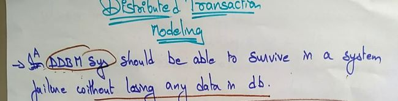

</div>
</div>

---

# Two-Phase Commit

<div class="grid grid-cols-2 gap-6">
<div>

<v-clicks>

- Un **coordinateur**
- Phase 1 (*prepare*) : tous confirment qu'ils *peuvent* valider, et **verrouillent**
- Phase 2 (*commit*) : le coordinateur ordonne la validation

</v-clicks>

<v-click>
<div class="mt-4 p-3 bg-red-700 rounded text-red-100">
Complexité, latence, faible résilience : si le coordinateur tombe, la transaction reste bloquée.
</div>
</v-click>

</div>
<div>

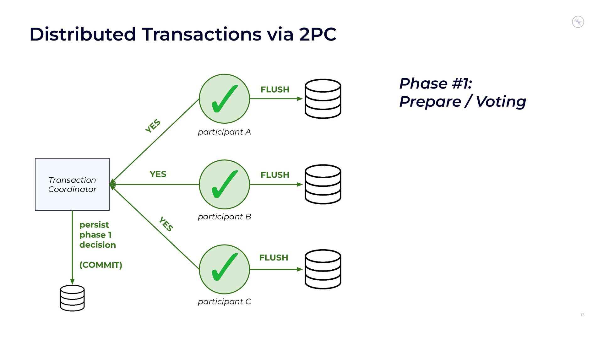

</div>
</div>

---

# 2PC chez El Choco : la commande répartie

Truffes chez A, tablette chez B : une boîte incomplète ne vaut rien.

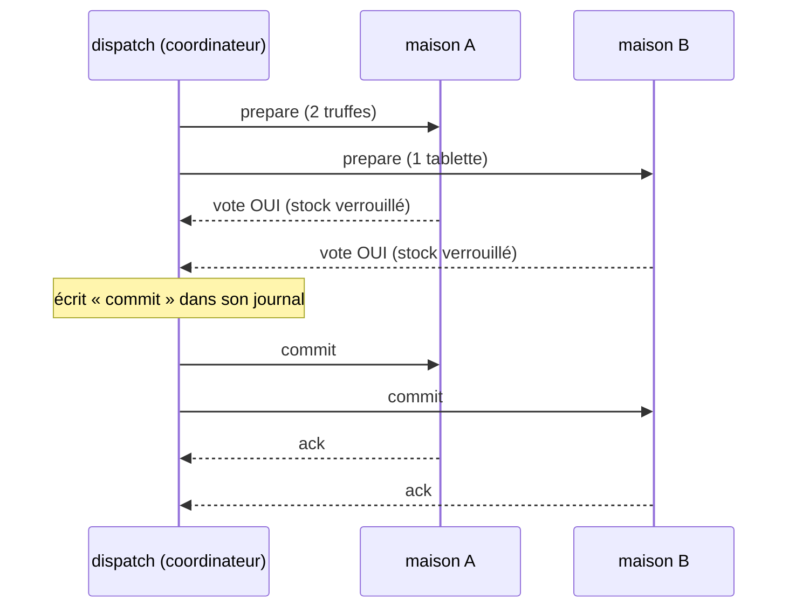

<v-click>
<div class="mt-1 p-2 bg-green-700 rounded text-green-200">
Un seul NON : <b>abort</b> pour tous. A et B finissent toujours dans le <b>même état</b>.
</div>
</v-click>

---

# 2PC : l'état « dans le doute »

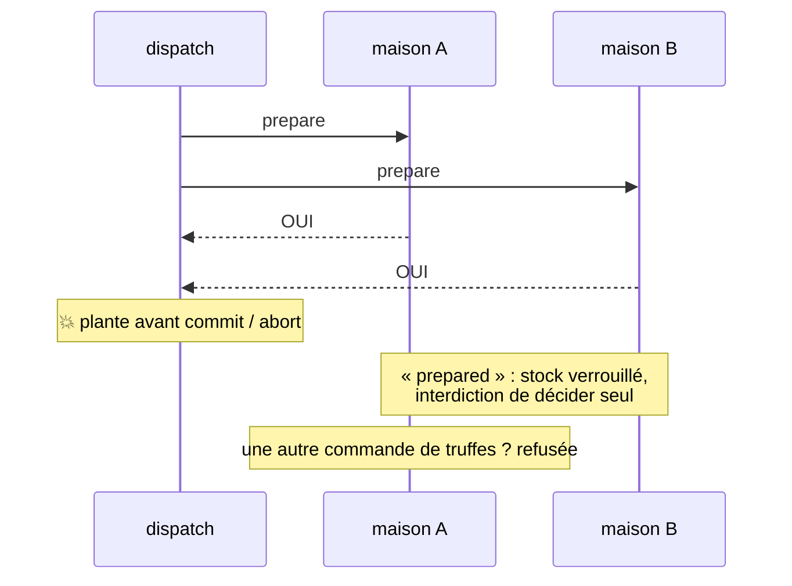

<v-click>
<div class="mt-1 p-2 bg-red-700 rounded text-red-100">
Un participant 2PC ne peut <b>pas</b> abandonner seul : le coordinateur a peut-être déjà écrit « commit ». Il attend. Labo : <code>docker compose pause dispatch</code> entre les deux phases.
</div>
</v-click>

---

# 2PC : la faille d'atomicité

dispatch envoie `commit`, A le reçoit, dispatch meurt **avant B** : A a validé, B est encore « prepared ».

<v-click>

| B choisit de… | Gagné | Perdu |
|---|---|---|
| **attendre** | atomicité, *à terme* | disponibilité : stock verrouillé |
| **abandonner** après un délai (interdit en 2PC) | disponibilité | atomicité : A validée, B annulée |

</v-click>

<v-click>
<div class="mt-4 p-3 bg-red-700 rounded text-red-100">
L'atomicité n'est ni <b>instantanée</b> ni gratuite : elle suppose que B accepte d'attendre, <b>sans limite de temps</b>. B peut interroger A ; si aucun pair joignable ne connaît la décision, il reste bloqué.
</div>
</v-click>

---

# Bloquer puis encaisser : un 2PC avec bail

Comme une carte de crédit à l'hôtel : on **bloque** à la réservation, on **encaisse** au départ.

| 2PC | Banque El Choco | Effet |
|---|---|---|
| *prepare* / vote | `hold` | montant **bloqué**, aucun argent ne bouge |
| *commit* | `collect` | débit + crédits, en une étape locale |
| *abort* | `unhold` | montant débloqué |
| — | **bail** (1 h) | le blocage expire **seul** |

<v-click>
<div class="mt-4 p-3 bg-green-700 rounded text-green-200">
Le bail choisit <b>abandonner</b> : la banque décide seule, ce n'est plus un vrai 2PC. Un participant peut alors avoir validé et pas la banque.
</div>
</v-click>

<v-click>
<div class="mt-2 p-3 bg-blue-800 rounded text-blue-100">
Si un état partiel est possible, autant le <b>prévoir</b> : comment défaire ce qui a déjà été fait ?
</div>
</v-click>

---
layout: section
---

# Partie 3
## Sagas

---

# Compenser plutôt que coordonner

<v-clicks>

- **2PC** : empêcher les états partiels, en **verrouillant**
- **Saga** : les accepter, chaque étape a une **action inverse**
- Pas de verrou global : résilience et scalabilité
- Adaptées aux microservices, à MQTT, et à des **administrateurs différents**

</v-clicks>

<v-click>
<div class="mt-4 p-3 bg-yellow-600 rounded text-yellow-200">
Chaque étape doit définir sa compensation, et les <b>états intermédiaires sont visibles</b> avant la fin.
</div>
</v-click>

---

# La saga El Choco : faire / défaire

<table>
  <thead>
    <tr><th>#</th><th>Participant</th><th>Faire</th><th>Défaire (compensation)</th></tr>
  </thead>
  <tbody>
    <tr v-click><td>1</td><td>maison</td><td><code>answer</code> accept : stock réservé</td><td><code>release/&lt;maison&gt;</code></td></tr>
    <tr v-click><td>2</td><td>bank</td><td><code>hold</code> : bloquer total + livraison</td><td><code>unhold</code></td></tr>
    <tr v-click><td>3</td><td>livreur</td><td><code>delivery</code> book : réserver la course</td><td><code>delivery</code> cancel</td></tr>
    <tr v-click><td><b>⇣</b></td><td><b>PIVOT</b></td><td><b><code>picked-up</code> : le colis quitte la maison</b></td><td><b>plus rien à défaire</b></td></tr>
    <tr v-click><td>4</td><td>livreur</td><td><code>delivered</code></td><td>—</td></tr>
    <tr v-click><td>5</td><td>bank</td><td><code>collect</code> : maison + livreur payés</td><td>aucune : <b>réessayer</b></td></tr>
  </tbody>
</table>

<v-click>
<div class="mt-4 p-3 bg-blue-800 rounded text-blue-100">
<code>unhold</code> n'est pas un remboursement : avant <code>collect</code>, l'argent n'a jamais bougé. Un remboursement serait une nouvelle opération, qui peut échouer.
</div>
</v-click>

---

# La saga qui réussit

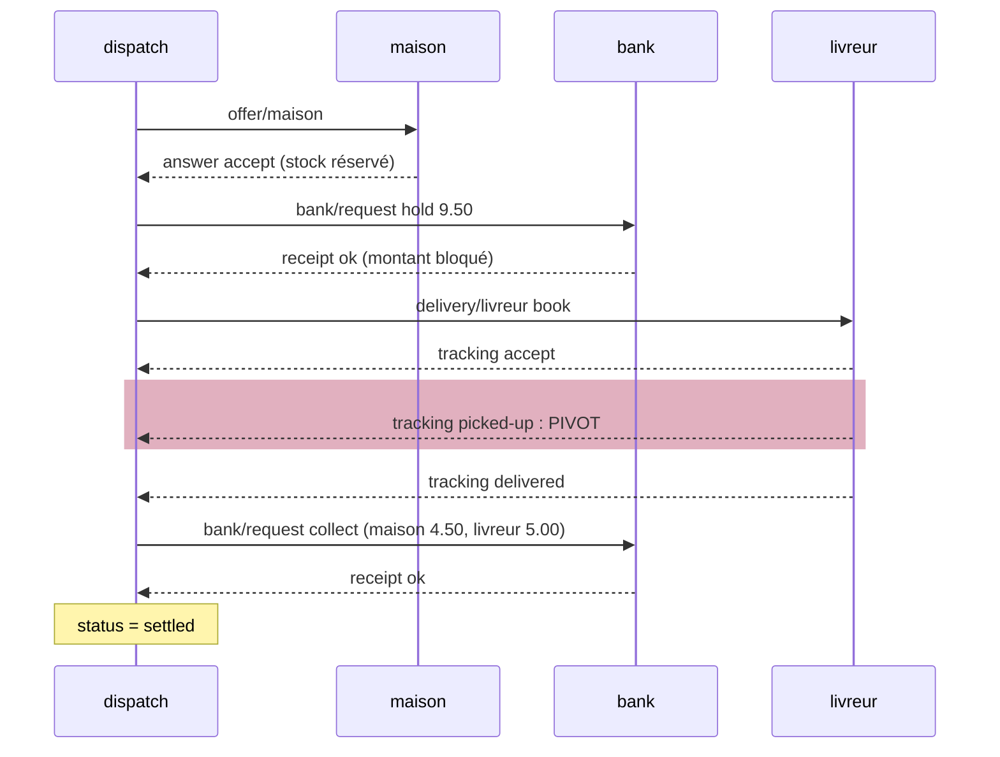

---

# En images 1/3 : commander, bloquer

La visiteuse n'est qu'une clé : un <code>orderId</code> et un code prépayé.

<div class="grid grid-cols-2 gap-4 items-start">
<div>

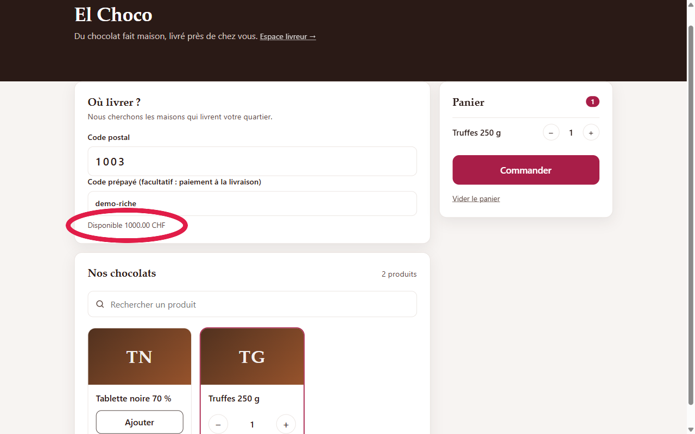
<p class="text-center text-sm opacity-75">Boutique : code prépayé, solde disponible</p>

</div>
<v-click>
<div>

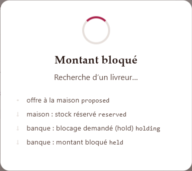
<p class="text-center text-sm opacity-75">Maison d'accord, montant bloqué (<code>held</code>)</p>

</div>
</v-click>
</div>

---

# En images 2/3 : le livreur, le pivot

Le livreur est un acteur, joué ici dans le navigateur (<code>/livreur.html</code>).

<div class="grid grid-cols-2 gap-4 items-start">
<div>

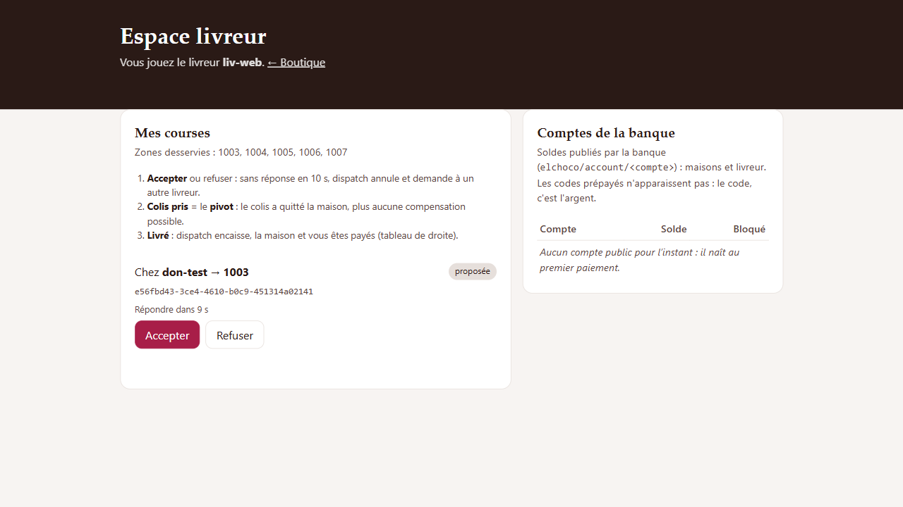
<p class="text-center text-sm opacity-75">Course proposée : 10 s pour répondre</p>

</div>
<v-click>
<div>

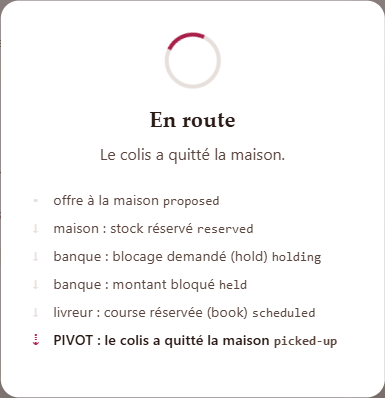
<p class="text-center text-sm opacity-75">« Colis pris » : le pivot, plus de retour possible</p>

</div>
</v-click>
</div>

<v-click>
<div class="mt-2 p-2 bg-yellow-600 rounded text-yellow-200">
Avant le pivot, la commande peut encore être annulée. Après, elle ne peut plus qu'avancer.
</div>
</v-click>

---

# En images 3/3 : encaisser

<code>collect</code> : une seule étape locale dans la banque, débit et crédits ensemble.

<div class="grid grid-cols-2 gap-4 items-start">
<div>

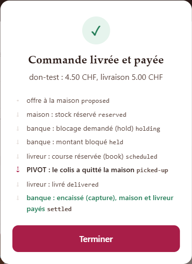
<p class="text-center text-sm opacity-75">Toutes les étapes, jusqu'à <code>settled</code></p>

</div>
<v-click>
<div>

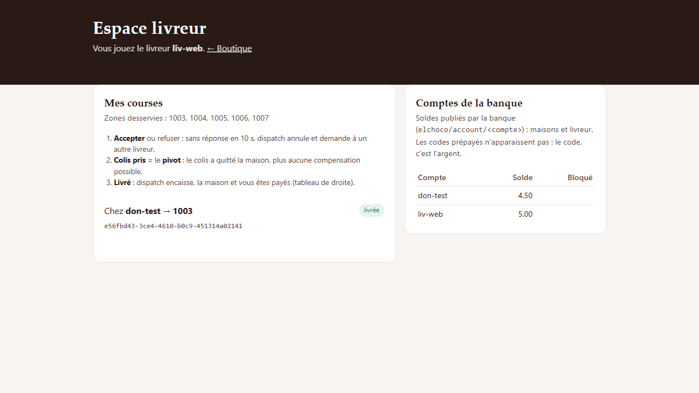
<p class="text-center text-sm opacity-75">Maison 4.50, livreur 5.00 ; la boutique affiche 990.50 disponibles</p>

</div>
</v-click>
</div>

---

# La saga qui se compense

Aucun livreur ne répond : on défait **dans l'ordre inverse**.

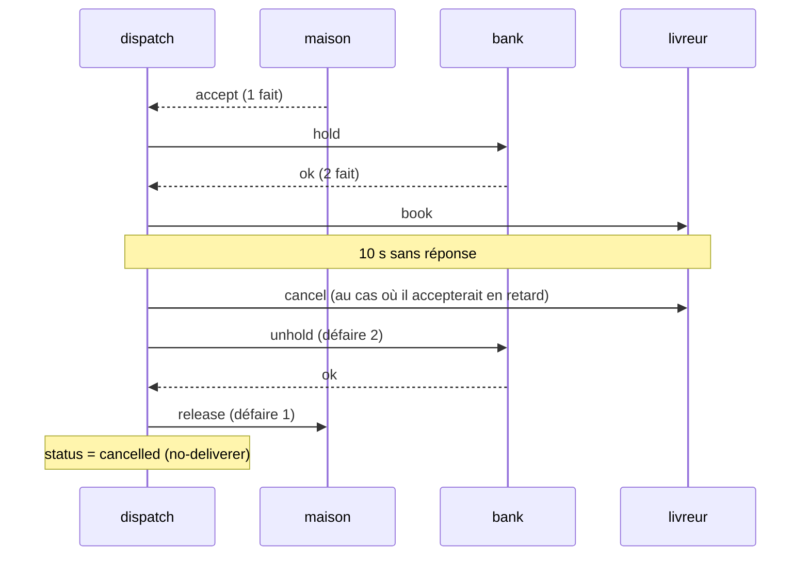

<v-click>
<div class="mt-1 p-2 bg-yellow-600 rounded text-yellow-200">
Une compensation doit <b>finir par réussir</b> : <code>unhold</code> est réessayé jusqu'à la réponse, et il réussit même s'il n'y a rien à débloquer.
</div>
</v-click>

---

# En images : compenser

Mêmes écrans, deux échecs avant le pivot.

<div class="grid grid-cols-2 gap-4 items-start">
<div>

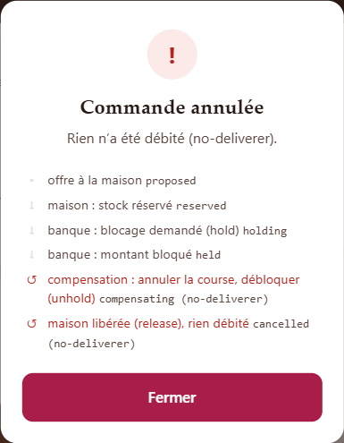
<p class="text-center text-sm opacity-75">Aucun livreur en 10 s : annuler, débloquer, libérer</p>

</div>
<v-click>
<div>

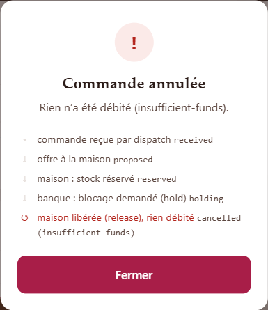
<p class="text-center text-sm opacity-75"><code>demo-pauvre</code> : blocage refusé, seule la maison est libérée</p>

</div>
</v-click>
</div>

<v-click>
<div class="mt-2 p-2 bg-green-700 rounded text-green-200">
Dans les deux cas : rien n'est débité, la maison récupère son stock, la liste des étapes montre chaque compensation (↺).
</div>
</v-click>

---

# Le pivot

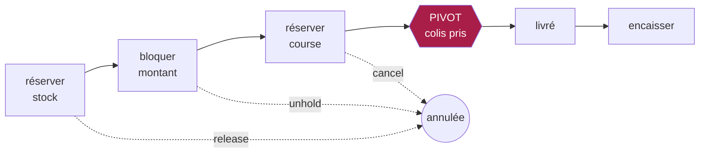

<v-clicks>

- **Avant** le pivot : chaque étape est **compensable**
- **Après** le pivot : chaque étape est **réessayable**, jamais compensée
- « Prévenir la banque à la livraison » suffit **seulement parce que** le montant a été bloqué avant : l'encaissement ne peut plus manquer de fonds

</v-clicks>

---

# Orchestration ou chorégraphie ?

<div class="grid grid-cols-2 gap-6">
<div>

### Orchestration (El Choco)

<v-clicks>

- dispatch décide chaque étape
- Un seul endroit tient l'état (`status/<orderId>`)
- Facile à suivre, facile à tester
- Le coordinateur est un point de panne

</v-clicks>

</div>
<v-click>
<div>

### Chorégraphie

- Chaque service réagit à l'événement précédent
- Pas de chef
- Difficile de garantir « jamais livrer sans paiement »
- L'état n'est nulle part en entier

</div>
</v-click>
</div>

---
layout: section
---

# Partie 4
## Rôle de l'idempotence

---

# Reprise après échec

<v-clicks>

- Chaque étape doit pouvoir être **répétée sans effet indésirable**
- **Identifiants uniques** pour détecter les doublons
- **Stockage des états** des transactions déjà traitées

</v-clicks>

<v-click>
<div class="mt-4 p-3 bg-red-700 rounded text-red-100">
Cas vicieux : le service exécute puis plante <b>avant de répondre</b>. L'appelant ignore si ça a eu lieu.
</div>
</v-click>

<v-click>
<div class="mt-4 p-3 bg-green-700 rounded text-green-200">
Seule réponse sûre : renvoyer la <b>même requête avec le même identifiant</b>, le service retourne le résultat de la première exécution.
</div>
</v-click>

---

# Le cas vicieux, en vrai

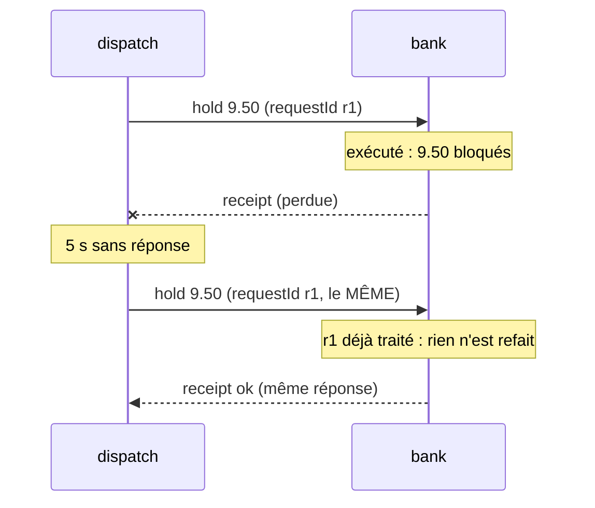

<v-click>
<div class="mt-1 p-2 bg-blue-800 rounded text-blue-100">
Labo : <code>BANK_LOSE_RECEIPTS=1</code> fait exécuter la demande sans répondre. Le journal de la banque affiche <code>doublon r1, même réponse</code> ; le solde n'est touché qu'une fois.
</div>
</v-click>

---

# Deux niveaux d'idempotence

<v-clicks>

- **Par message** : la banque garde les `requestId` déjà traités (mémoire **bornée** : 1000)
- **Par métier** : un `hold` pour une commande qui a déjà le sien répond `ok` sans rebloquer ; `unhold` sans blocage répond `ok`
- Si la mémoire déborde, la clé métier `orderId` protège encore `hold` et `unhold`

</v-clicks>

<v-click>
<div class="mt-4 p-3 bg-yellow-600 rounded text-yellow-200">
Banque muette après 3 essais : résultat <b>inconnu</b>. dispatch compense quand même. Défaire ce qui n'a peut-être pas eu lieu est sans danger, parce que <code>unhold</code> est idempotent.
</div>
</v-click>

---
layout: section
---

# Partie 5
## Choisir

---

# Comparaison des modèles

| Modèle            | Principe                                   | El Choco                                      |
|-------------------|--------------------------------------------|-----------------------------------------------|
| ACID local        | une transaction dans un seul service        | `collect` : débit et crédits dans la banque    |
| Distribué (2PC)   | prepare / vote / commit, verrous            | commande répartie sur plusieurs maisons        |
| Saga              | étapes indépendantes + compensations        | maison, banque, livreur : administrateurs différents |

<v-click>

### Recommandations

1. La meilleure transaction distribuée est **celle qu'on évite** : regrouper les données (tous les comptes dans la banque)
2. **2PC** dans un domaine de confiance, court, quand l'isolation compte
3. **Sagas** entre administrateurs différents, avec un **pivot** explicite
4. Chaque étape **idempotente**, identifiée ; **suivre les états** dans `status`

</v-click>

---
layout: section
---

# Partie 6
## Faire évoluer le contrat

---

# Pourquoi la saga impose une v3

<div class="grid grid-cols-2 gap-6">
<div>

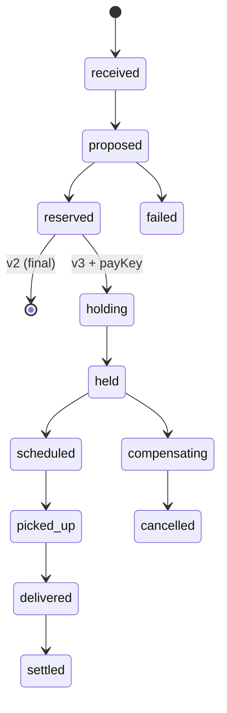

</div>
<div>

<v-clicks>

- Ajouter des types (`bank`, `delivery`…) : **additif**
- Ajouter `held`, `settled`… à `state` : **cassant**, un lecteur v2 refuse la valeur
- `reserved` n'est plus **final** : **cassant**, un lecteur v2 compterait réussie une commande annulée ensuite
- `additionalProperties: false` n'y change rien : il concerne les champs, pas les valeurs

</v-clicks>

</div>
</div>

---

# Migrer : lecteurs d'abord

<v-clicks>

1. **Élargir** : chaque nœud accepte `v: 2` et `v: 3` (schémas `v3/`)
2. **Basculer** : quand tous lisent v3, les émetteurs publient `v: 3`
3. **Resserrer** : v2 dépréciée (mode dégradé, avertissement), retirée le 15.01.2027

</v-clicks>

<v-click>
<div class="mt-4 p-3 bg-blue-800 rounded text-blue-100">
Exercice : passer <b>sa maison</b> en v3. Les messages <code>offer</code> et <code>answer</code> ne changent pas de forme ; il faut accepter <code>v: 3</code>, publier <code>v: 3</code>, et écouter <code>release/&lt;maison&gt;</code> pour libérer une réservation.
</div>
</v-click>

---
layout: section
---

# Fallacies associées
## Le piège et comment l'éviter

---

# Fallacy 1 : le réseau est fiable

<v-click>
<div class="mt-1 p-3 bg-red-700 rounded text-red-100">
<b>Ce qui arrive :</b> Les messages se perdent, se dupliquent, les nœuds meurent sans prévenir.
</div>
</v-click>

<v-click>
<div class="mt-2 p-3 bg-green-700 rounded text-green-200">
<b>Mieux faire :</b> Accusés de réception, retries avec backoff, idempotence, LWT et heartbeat pour détecter les morts.
</div>
</v-click>

<v-click>
<div class="mt-2 p-3 bg-blue-800 rounded text-blue-100">
<b>Exemple :</b> La banque bloque le montant puis sa réponse se perd. dispatch renvoie le même <code>requestId</code> ; la banque répond sans rebloquer. Un <code>delivered</code> qui arrive avant un <code>picked-up</code> perdu implique le pivot.
</div>
</v-click>

---

# Fallacy 6 : il n'y a qu'un administrateur

<v-click>
<div class="mt-1 p-3 bg-red-700 rounded text-red-100">
<b>Ce qui arrive :</b> Plusieurs équipes déploient à leur rythme avec leurs règles : une modification locale casse les autres.
</div>
</v-click>

<v-click>
<div class="mt-2 p-3 bg-green-700 rounded text-green-200">
<b>Mieux faire :</b> Contrats explicites et versionnés, compatibilité ascendante, journaux signés, décisions de confiance documentées.
</div>
</v-click>

<v-click>
<div class="mt-2 p-3 bg-blue-800 rounded text-blue-100">
<b>Exemple :</b> La banque (El Contador) et les livreurs ne laissent pas dispatch verrouiller leurs ressources : pas de 2PC, une saga. Et la saga elle-même impose une v3 que chaque maison adopte à son rythme.
</div>
</v-click>

---

# Une faille à discuter : le code, c'est l'argent

La page livreur ne liste plus les codes prépayés. Le bus, lui, les montre à tout abonné :

```sh
$ mosquitto_sub -t 'elchoco/account/#' -v
elchoco/account/demo-riche  {"v":3,"from":"bank",…,"payload":{"balanceCents":99050,"heldCents":0}}
elchoco/account/demo-pauvre {"v":3,"from":"bank",…,"payload":{"balanceCents":500,"heldCents":0}}
elchoco/account/don-test    {"v":3,"from":"bank",…,"payload":{"balanceCents":450,"heldCents":0}}
```

<v-clicks>

- **Qu'est-ce qui rend le code secret ?** Le nom du topic le révèle, il est court (devinable), et n'importe qui peut publier sur `bank/request` pour le dépenser
- **Corriger, et à quel prix ?** Code long et aléatoire, topic = empreinte (*hash*) du code, ACL du broker, demandes signées, ne pas publier les soldes prépayés
- **Et la saga ?** Un code volé fait réussir le `hold` du voleur : idempotence et compensations protègent des **pannes**, pas d'un **attaquant**

</v-clicks>

<v-click>
<div class="mt-2 p-2 bg-red-700 rounded text-red-100">
Fallacy 4 (le réseau est sûr) : cacher un secret dans l'interface n'est pas le protéger. Suite au thème <b>sécurité</b>.
</div>
</v-click>

---

# Au labo

```sh
pnpm --filter @elchoco/bank start        # la banque (demo-riche, demo-pauvre)
pnpm --filter @elchoco/dispatch start    # l'orchestrateur de la saga
pnpm --filter @elchoco/web-order start   # boutique + espace livreur
```

<v-clicks>

- Boutique `/` : commander avec le code `demo-riche`, suivre les étapes de la saga
- Espace livreur `/livreur.html` : accepter, **colis pris** (pivot), livré ; voir la maison payée
- `demo-pauvre` : refus `insufficient-funds`, la maison est libérée
- Ne pas répondre en 10 s : compensation complète, solde inchangé
- `BANK_LOSE_RECEIPTS=1` : le cas vicieux

</v-clicks>

---
layout: center
class: text-center
---

<v-click every=1>
Idempotence + compensations + pivot : cohérence et résilience malgré les défaillances.

<div class="pt-12 mb-4">
  <span class="px-4 py-2 rounded bg-blue-500 text-white text-xl">
    Compensable avant le pivot, réessayable après
  </span>
</div>

# Questions ?

<div class="mt-8 text-gray-500">

Prochaine étape : design for failure

</div>
</v-click>
