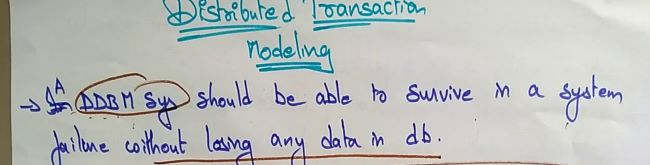
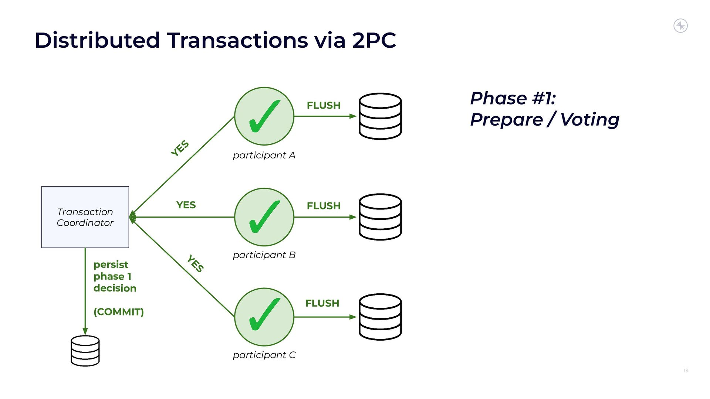
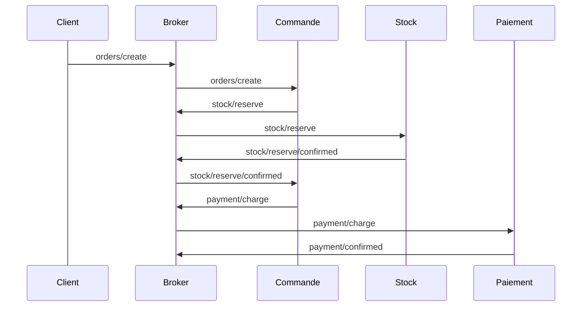

# Transactions

## Cohérence à terme, compensations

  
    Fallacies 1 et 6
  

---

# Plan de la présentation

1. **ACID** - propriétés d'une transaction
2. **Distribué** - coordinateur et 2PC
3. **Sagas** - compensations
4. **Idempotence** - reprise après échec
5. **Choisir** - comparaison et recommandations
6. **Fallacies associées** - le piège et comment l'éviter

---
layout: section
---

# Partie 1
## ACID

---

# Qu'est-ce qu'une transaction ?

Une unité logique de travail, selon les propriétés **ACID** :

<v-clicks>

1. **Atomicité** : tout réussit ou tout échoue
2. **Cohérence** : l'état reste valide avant et après
3. **Isolation** : invisible aux autres avant le *commit*
4. **Durabilité** : l'effet est permanent, même en cas de panne

</v-clicks>

<v-click>

Entre deux services indépendants, pas d'atomicité « gratuite ». Le pire n'est pas l'échec, c'est le <b>résultat inconnu</b>.

</v-click>

---
layout: section
---

# Partie 2
## Transactions distribuées

---

# Commande : trois sous-opérations

<v-clicks>

1. Le client passe commande
2. Le stock est mis à jour
3. Le paiement est validé

Si une étape échoue : *rollback* de toutes les autres.

</v-clicks>

---

# Two-Phase Commit

<v-clicks>

- Un **coordinateur**
- Phase 1 : tous confirment qu'ils *peuvent* valider
- Phase 2 : le coordinateur ordonne la validation

</v-clicks>

<v-click>

Complexité, latence, faible résilience : si le coordinateur tombe, la transaction reste bloquée.

</v-click>

---

# Exemple MQTT en trois étapes

---
layout: section
---

# Partie 3
## Sagas

---

# Compenser plutôt que coordonner

<v-clicks>

- Une **saga** : transaction « longue », chaque étape a une **action inverse**
- Exemple : créer la commande, sortir du stock, débiter. Le débit échoue : remettre en stock, supprimer la commande
- Pas de coordinateur central : résilience et scalabilité
- Adaptées aux microservices et à MQTT

</v-clicks>

<v-click>

Chaque étape doit définir sa compensation, et les <b>états intermédiaires sont visibles</b> avant la fin.

</v-click>

---
layout: section
---

# Partie 4
## Rôle de l'idempotence

---

# Reprise après échec

<v-clicks>

- Chaque étape doit pouvoir être **répétée sans effet indésirable**
- **Identifiants uniques** pour détecter les doublons
- **Stockage des états** des transactions déjà traitées

</v-clicks>

<v-click>

Cas vicieux : le service exécute puis plante <b>avant de répondre</b>. L'appelant ignore si ça a eu lieu.

</v-click>

<v-click>

Seule réponse sûre : renvoyer la <b>même requête avec le même identifiant</b>, le service retourne le résultat de la première exécution.

</v-click>

---
layout: section
---

# Partie 5
## Choisir

---

# Comparaison des modèles

| Modèle            | Principe                                   | Convient à                           |
|-------------------|--------------------------------------------|--------------------------------------|
| Centralisé (ACID) | une transaction globale                    | monolithes, peu distribués           |
| Distribué (2PC)   | coordination par protocole commun          | cohérence forte nécessaire           |
| Saga              | étapes indépendantes + compensations       | microservices, asynchrone            |

<v-click>

### Recommandations

1. Chaque étape **idempotente**, identifiée
2. **Sagas** par défaut en distribué
3. **Suivre les états** (`en cours`, `payée`, `annulée`)
4. Outils : *Outbox pattern*, middleware transactionnel

</v-click>

---
layout: section
---

# Fallacies associées
## Le piège et comment l'éviter

---

# Fallacy 1 : le réseau est fiable

<v-click>

<b>Ce qui arrive :</b> Les messages se perdent, se dupliquent, les nœuds meurent sans prévenir.

</v-click>

<v-click>

<b>Mieux faire :</b> Accusés de réception, retries avec backoff, idempotence, LWT et heartbeat pour détecter les morts.

</v-click>

<v-click>

<b>Exemple :</b> Le service paie puis plante avant de répondre : l'appelant ignore le résultat. Renvoyer la même requête avec le même identifiant.

</v-click>

---

# Fallacy 6 : il n'y a qu'un administrateur

<v-click>

<b>Ce qui arrive :</b> Plusieurs équipes déploient à leur rythme avec leurs règles : une modification locale casse les autres.

</v-click>

<v-click>

<b>Mieux faire :</b> Contrats explicites et versionnés, compatibilité ascendante, journaux signés, décisions de confiance documentées.

</v-click>

<v-click>

<b>Exemple :</b> Banque et coopérative sont administrées séparément : pas de transaction ACID commune. Saga avec compensations et états visibles.

</v-click>

---
layout: center
class: text-center
---

<v-click every=1>
Idempotence + compensations : cohérence et résilience malgré les défaillances.

  
    Étapes idempotentes, compensations explicites
  

# Questions ?

Prochaine étape : design for failure

</v-click>
