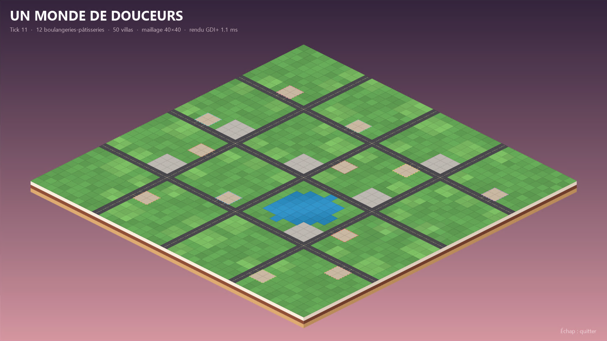

# Sérialisation

Des échanges de données entre des programmes qui ne partagent ni mémoire ni langage.

**À l'issue de cette thématique, vous serez capable de :**
- expliquer pourquoi un objet doit être sérialisé pour traverser un réseau
- comparer un format texte et un format binaire (poids, lisibilité, évolution)
- écrire un message conforme à un contrat JSON Schema et refuser un message non conforme
- expliquer pourquoi renommer un champ casse un autre groupe

**Fallacies :**

- [3 — La bande passante est infinie](../supports/fallacies.md#fallacy-3)
- [8 — Le réseau est homogène](../supports/fallacies.md#fallacy-8)

Voir [les 8 fallacies](../supports/fallacies.md).

## Théorie
- [Sérialisation](../supports/Sérialisation.md)
- [Contrat de base](../activites/contrats/README.md) (enveloppe et JSON Schema)
- Slides : [Sérialisation](../slides/serialisation/){target="_self"}

## Drill
- [D01 — Sérialisation : ça pèse combien, qu'est-ce qui casse ?](../activites/drills/D01-serialisation.md)

## Chat
- [C1 — Hello chat](../activites/chat/C1-hello.md) : choisir son langage, envoyer et recevoir des messages valides

## Exigences du fil rouge

Quel que soit le scénario choisi, il doit, pour cette thématique :

- **Services attendus :** [Vitrine / état public](../activites/fil-rouge/services.md#cat-vitrine), [Passerelle / adaptateur](../activites/fil-rouge/services.md#cat-passerelle)
- **Doit introduire :** au moins un type de donnée métier échangé entre nœuds, avec un schéma écrit et partagé
- **Preuve attendue :** un message valide contre le schéma ; trois entrées hostiles (texte non JSON, champ manquant, type inconnu) ignorées proprement, sans plantage
- **Décision à documenter :** le format choisi et la taille des messages, avec la raison (fallacy 3)

## Fil rouge

| Fil rouge  | Activité                                                              |
|------------|-----------------------------------------------------------------------|
| UMDD       | [La vitrine](../activites/fil-rouge/umdd/vitrine.md)                  |
| Powercher  | [Powercher](../activites/fil-rouge/powercher/README.md#serialisation) |
| Pedaloland | [Mapping](../activites/fil-rouge/pedalo/README.md)                    |
| Libre      | [Fil rouge libre](../activites/fil-rouge/libre/README.md) (à construire avec le [gabarit](../activites/fil-rouge/modele/README.md)) |

Activité alternative : [Sérialise ma série](../activites/serial/README.md)
