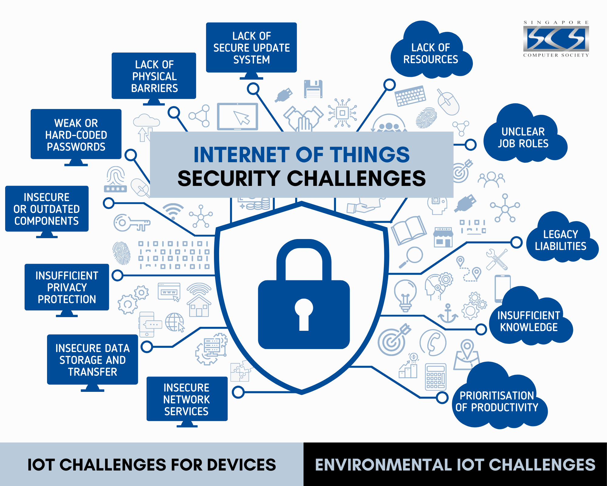

# Sécurité dans un réseau distribué

Malgré les opportunités présentées dans l'image, nous nous limitons à 2 éléments clés 🔑 : la **confidentialité** et le **réseau de confiance**.

**À l'issue de cette thématique, vous serez capable de :**
- associer une attaque à la propriété violée (confidentialité, intégrité, authenticité, fraîcheur)
- signer et vérifier un message et refuser modification, usurpation et rejeu
- décider en équipe ce que l'on signe et comment les clés sont distribuées
- expliquer ce que la signature seule ne protège pas

**Fallacies :**

- [4 — Le réseau est sûr](../supports/fallacies.md#fallacy-4)
- [6 — Il n’y a qu’un administrateur](../supports/fallacies.md#fallacy-6)

Voir [les 8 fallacies](../supports/fallacies.md).

## Théorie
- [Sécurité](../supports/securite.md) (vocabulaire)
- [Confidentialité](../supports/confidentialite.md)
- [Réseau de confiance](../supports/reseau-confiance.md)
- [Kahoot confidentialité / confiance](https://create.kahoot.it/share/321-confidentialite-confiance/9fdf010f-682c-42c5-bc7e-2188d553bebd)
- Slides : [Sécurité](../slides/securite/){target="_blank"}
- Slides : [Confidentialité](../slides/confidentialite/){target="_blank"}
- Slides : [Réseau de confiance](../slides/reseau-confiance/){target="_blank"}

## Drill
- [D09 — Sécurité : signature, chiffrement, rejeu](../activites/drills/D09-securite.md)

## Chat
- [C7 — Prouver l'auteur, refuser le rejeu](../activites/chat/C7-confiance.md)

## Exigences du fil rouge

Quel que soit le scénario choisi, il doit, pour cette thématique :

- **Services attendus :** [Identité et confiance](../activites/fil-rouge/services.md#cat-identite), [Passerelle / adaptateur](../activites/fil-rouge/services.md#cat-passerelle)
- **Doit introduire :** un auteur dont il faut prouver l'identité et au moins une donnée à protéger
- **Preuve attendue :** un message usurpé ou rejoué est refusé ; si la confidentialité est visée, un espion sur le bus ne voit que du chiffré
- **Décision à documenter :** qui fait confiance à qui, et comment les clés sont distribuées

## Fil rouge

| Fil rouge  | Activité                                                         |
|------------|------------------------------------------------------------------|
| UMDD       | [Sécurité](../activites/fil-rouge/umdd/securite.md)              |
| Powercher  | [Powercher](../activites/fil-rouge/powercher/README.md#securite) |
| Pedaloland | [Mapping](../activites/fil-rouge/pedalo/README.md)               |
| Libre      | [Fil rouge libre](../activites/fil-rouge/libre/README.md) (à construire avec le [gabarit](../activites/fil-rouge/modele/README.md)) |

Activité alternative : [Réseau de confiance (AES)](../activites/aie_confiance/README.md)
